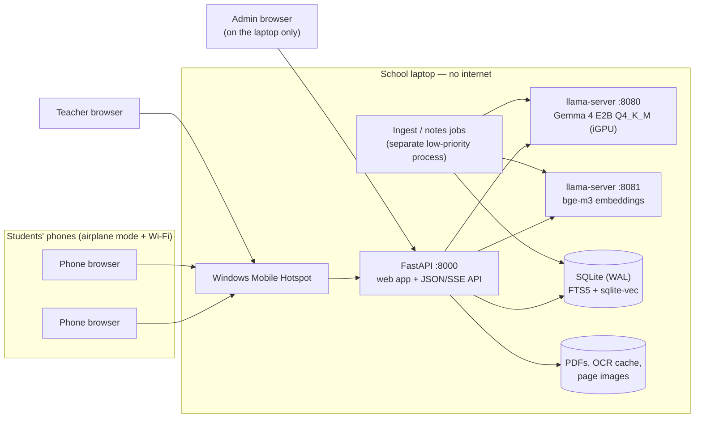
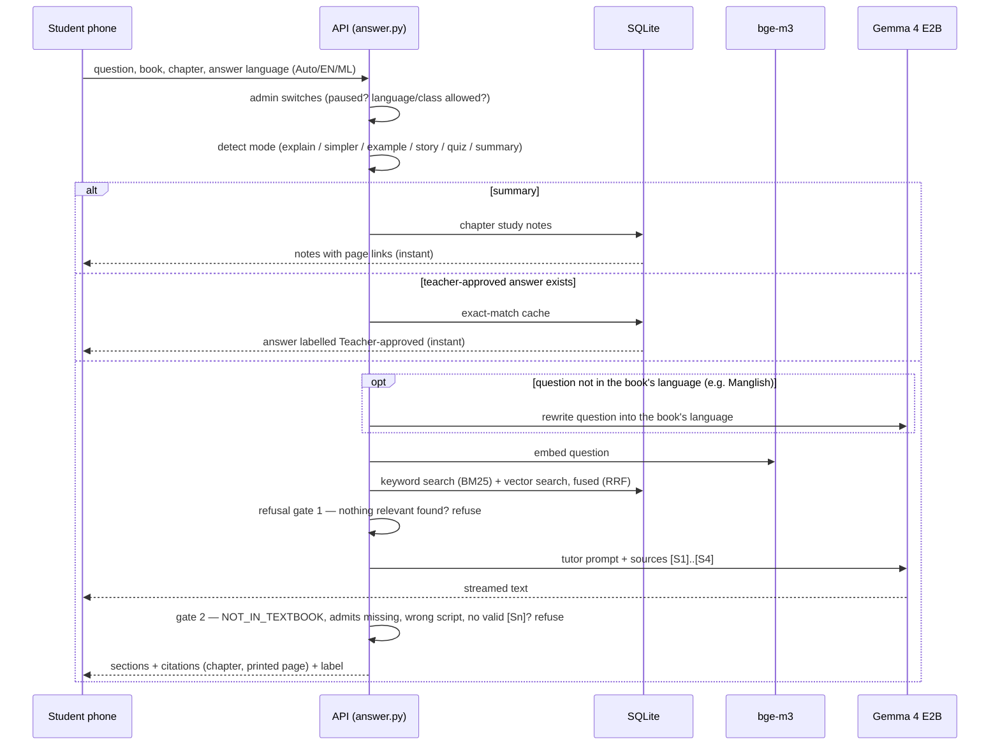
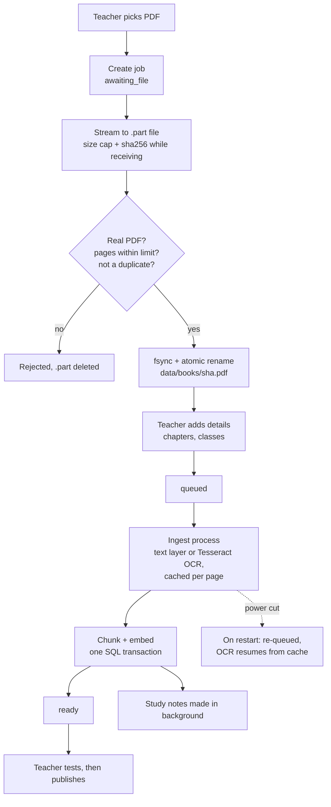
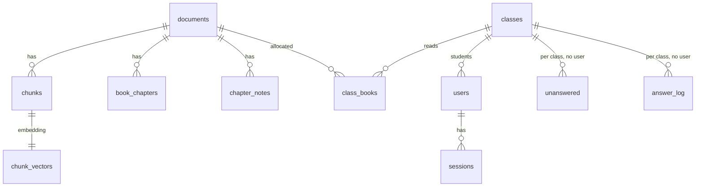

# RuralMinds — Technical Design

**What it is:** an offline learning server for one school. A laptop in the classroom runs the AI and hosts the Wi-Fi, and students use a phone browser. There are no internet calls anywhere in the answer path.

## 1. Deployment

- The model servers listen only on `127.0.0.1`.
- Admin pages answer only requests made from the laptop itself.

## 2. How one question is answered

**Grounding guarantees**
- The model never sees page numbers. It cites `[S1]`, `[S2]` and so on, and the server maps each one to a chapter and printed page from its own tables, so a page number cannot be invented.
- Everyday examples may come from outside the book only in a box marked *not from your book*.
- Refused questions go to the teacher inbox, counted, with no student identifier.

## 3. Book upload (power-cut safe)

A janitor removes unfinished uploads and files that no book refers to, so the disk never fills with leftovers.

## 4. Data model (SQLite, `apps/api/src/ruralminds/schema.sql`)

**Privacy by design**
- `users` holds a username, role and class only.
- No table links a question to a user. A unit test (`test_no_table_links_questions_to_accounts`) enforces this.

## 5. Components

| Part | File(s) | Job |
|---|---|---|
| Web API | `apps/api/src/ruralminds/main.py`, `api_student.py`, `api_teacher.py`, `api_admin.py` | Routes per role, serves the built web app |
| Answering | `answer.py`, `tutor.py`, `prompts/` | Modes, language rules, prompt, streaming, refusal checks |
| Search | `retrieve.py`, `textnorm.py` | Hybrid BM25 + vector search, Malayalam text normalisation |
| Books | `ingest.py`, `pages.py`, `chunker.py`, `uploads.py` | PDF → text or OCR → chunks → vectors; upload pipeline, janitor |
| Study notes | `notes.py` | Per-chapter key points with page ranges, plus an overview |
| Accounts | `auth.py`, `admin.py` | scrypt passwords, hashed session tokens, admin CLI |
| Admin switches, stats | `controls.py`, `stats.py` | Pause, language/class limits, class-level counts |
| Frontend | `frontend/src` (SvelteKit, static) | Student app, teacher and admin consoles, English/Malayalam UI |
| Evaluation | `eval/run.py`, `eval/samples/`, `eval/results/` | Recall@3, citation support, refusal accuracy, timings |

## 6. Technology choices

| Need | Choice | Why |
|---|---|---|
| Model runtime | llama.cpp `llama-server` (Vulkan on the iGPU) | Handles requests in parallel, OpenAI-style API; Ollama queues one request at a time |
| Model | Gemma 4 E2B Q4_K_M | Won the bake-off on speed in Malayalam: first word 9 s vs 66 s for Qwen3-4B (Qwen needed 3.4× the tokens for Malayalam text) |
| Embeddings | bge-m3 | Multilingual, works across English and Malayalam |
| Storage | One SQLite file (FTS5 + sqlite-vec, WAL) | No extra server, survives power cuts |
| PDF | pypdfium2 + Tesseract (`mal`, `eng`) | Permissive licences; the Malayalam PDFs use legacy fonts and need OCR |
| Frontend | SvelteKit static build, bundled local fonts | 94 KB gzipped (JS/CSS/HTML); no CDN |

All decisions and the measurements behind them are recorded in [`DECISIONS.md`](DECISIONS.md). The answer contract is in [`ANSWER_POLICY.md`](ANSWER_POLICY.md).
