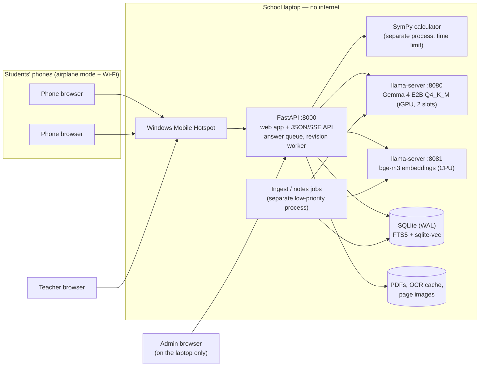
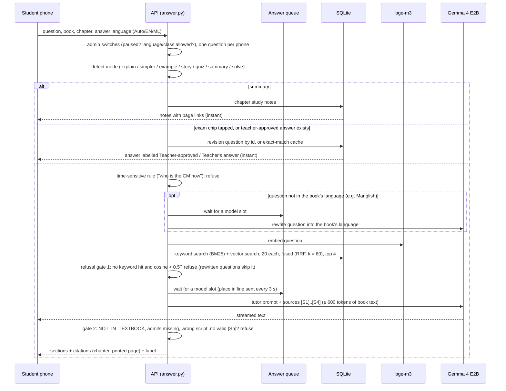
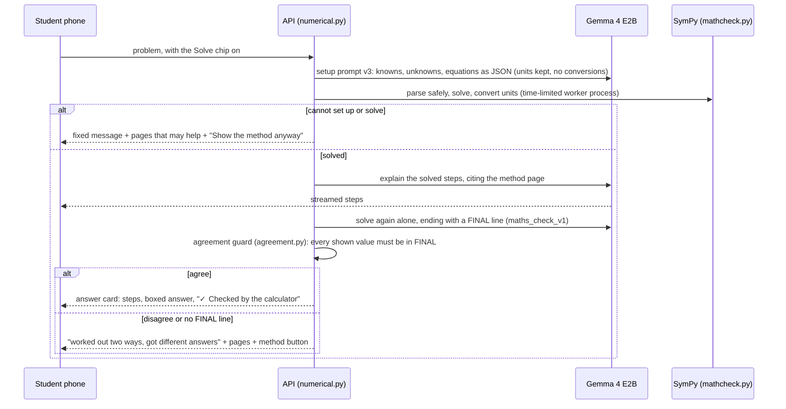
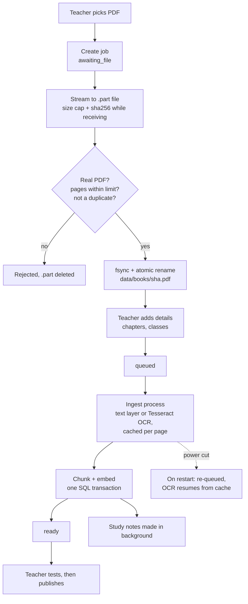
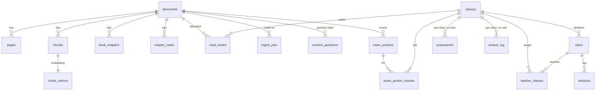

# RuralMinds — Technical Design

**What it is:** an offline learning server for one school. A laptop in the classroom runs the AI and hosts the Wi-Fi, and students use a phone browser. There are no internet calls anywhere in the answer path.

_State on 26 Oct 2026._ Measured numbers live in [`workstreams/evaluation-register.md`](workstreams/evaluation-register.md), with the result file and validity of each. This document only describes the design.

## 1. Deployment

- The model servers listen only on `127.0.0.1`.
- Admin pages answer only requests made from the laptop itself.
- Fallback network: Ubuntu with a NetworkManager hotspot and `dnsmasq` (`ruralminds.lan`). Never `.local`.

## 2. How one question is answered

**Grounding guarantees**
- The model never sees page numbers. It cites `[S1]`, `[S2]` and so on, and the server maps each one to a chapter and printed page from its own tables, so a page number cannot be invented.
- Tapping a citation opens an image of the printed page (`/api/page/{document}/{page}.png`).
- Everyday examples may come from outside the book only in a box marked *not from your book*.
- Refused questions go to the teacher inbox, counted, with no student identifier.

**Load control** (all in memory, no per-student data)
- One FIFO queue in front of the two model slots. Refusals and instant answers never enter it.
- A waiting phone gets its place in line and a wait estimate every 3 s. The estimate uses the measured gap between finished answers, because the two slots share one GPU.
- A new question is turned away ("busy") when the predicted wait is over 180 s or 30 phones are waiting.
- A phone that disconnects gives back its place at once.

## 3. "Solve step by step" (Science numericals, English)

- The answer card is hint-first: steps open one at a time, and the boxed answer only on "Show the answer".
- "Show the method anyway" answers without the calculator and is marked "may be wrong".
- Malayalam answer language gets the fixed message; solving is English only until a Malayalam slice passes.

## 4. Exam revision

- A teacher sets an exam portion: book, chapters, classes, show-from and exam dates. A portion refuses a class that does not use the book.
- The revision worker (`revision_worker.py`) runs only when answering is not paused, the queue is empty, no model slot is busy and no phone has asked for 45 s. It takes one model call per step.
- It drafts questions from the chapter's study notes and answers them through the normal pipeline. A question the book cannot answer is set aside.
- The teacher approves, edits or rejects each answer beside the cited page.
- Students see approved questions as chips, served by question id with no model call. Approved cited answers also go into the exact-match cache for typed questions.

## 5. Book upload (power-cut safe)

- A page goes to Tesseract (`mal`/`eng`, 300 dpi) when less than 60% of its text is in the expected script. The Malayalam PDFs use legacy ML-TT fonts, so their text layer is unusable.
- Malayalam text is normalised (chillu forms) before indexing and searching.
- Chunks follow sentence boundaries: about 1000 characters, at most 1600.
- A janitor removes unfinished uploads and files that no book refers to, so the disk never fills with leftovers.

## 6. Data model (SQLite schema v4, `apps/api/src/ruralminds/schema.sql`)

`answer_cache` (teacher-approved answers, exact-match key) and `settings` (admin switches) stand alone. `chunk_vectors` is the sqlite-vec table; FTS5 indexes the chunk text.

**Privacy by design**
- `users` holds a username, role and class only.
- No table links a question to a user. A unit test (`test_no_table_links_questions_to_accounts`) enforces this.
- Revision questions record which *staff* member wrote or approved them, never a student.

## 7. Components

| Part | File(s) | Job |
|---|---|---|
| Web API | `apps/api/src/ruralminds/main.py`, `api_student.py`, `api_teacher.py`, `api_admin.py`, `api_common.py` | Routes per role, serves the built web app |
| Answering | `answer.py`, `tutor.py`, `prompts/` | Modes, language rules, prompt, streaming, refusal checks, answer queue |
| Search | `retrieve.py`, `textnorm.py` | Hybrid BM25 + vector search, RRF, Malayalam text normalisation |
| Books | `ingest.py`, `pages.py`, `chunker.py`, `uploads.py`, `pagepng.py` | PDF → text or OCR → chunks → vectors; upload pipeline, janitor; page images |
| Study notes | `notes.py` | Per-chapter key points with page ranges, plus an overview |
| Exam revision | `exams.py`, `revision_worker.py` | Exam portions, question bank, idle-time drafting |
| Numericals | `numerical.py`, `mathcheck.py`, `agreement.py` | Solve chip: equation setup, SymPy solve and units, agreement guard |
| Cache | `cache.py` | Exact-match teacher-approved answers (no semantic matching) |
| Accounts | `auth.py`, `admin.py` | scrypt passwords, hashed session tokens, HttpOnly SameSite=Strict cookies, admin CLI |
| Admin switches, stats | `controls.py`, `stats.py` | Pause, language/class limits, class-level counts |
| Frontend | `frontend/src` (SvelteKit, static) | Student app, teacher and admin consoles, English/Malayalam UI |
| Evaluation | `eval/run.py`, `eval/split.py`, `eval/metrics.py`, `eval/bench.py`, `eval/numerical.py`, `eval/grade.py`, `eval/datasets/`, `eval/results/` | Frozen dev/test split; hit@k, MRR, citation support, refusal precision/recall with Wilson intervals; first-word and total latency; load bench; numericals bench; human-grading sheets |

## 8. Technology choices

| Need | Choice | Why |
|---|---|---|
| Model runtime | llama.cpp `llama-server` (Vulkan on the iGPU) | Handles requests in parallel, OpenAI-style API; Ollama queues one request at a time. Vulkan prefill 146 vs 53 tok/s on CPU (llama-bench pp512); flash attention off on this iGPU (35–46 tok/s when on) |
| Model | Gemma 4 E2B Q4_K_M, pinned | Won the 12 Oct bake-off against Qwen3-4B-Instruct-2507 on 20 dev items: in Malayalam 8/8 cited vs 7/8, and first word p50 9.0 s vs 65.9 s (indicative, small n) |
| Embeddings | bge-m3 (GGUF, second `llama-server --embedding`) | Multilingual, works across English and Malayalam; keeps the stack torch-free |
| Storage | One SQLite file (FTS5 + sqlite-vec, WAL) | No extra server, survives power cuts; whole-book search p50 177 ms |
| PDF | pypdfium2 + Tesseract (`mal`, `eng`) | Permissive licences (PyMuPDF is AGPL); the Malayalam PDFs use legacy fonts and need OCR |
| Calculator | SymPy in a separate worker process | Checks the arithmetic of numericals; a time limit and size caps keep a bad setup from hanging the server |
| Frontend | SvelteKit static build, bundled local fonts | About 116 KB gzipped (JS, CSS and HTML in `frontend/build`, measured 26 Oct) plus fonts (Inter 48 KB; Noto Sans Malayalam 89 KB, loaded only when Malayalam is on screen); no CDN |

All decisions and the measurements behind them are recorded in [`DECISIONS.md`](DECISIONS.md). The answer contract is in [`ANSWER_POLICY.md`](ANSWER_POLICY.md).
