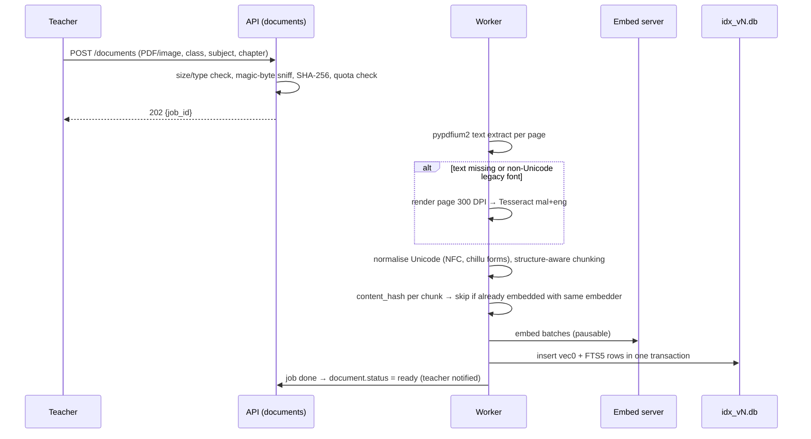
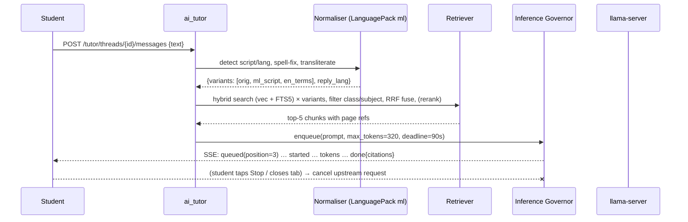
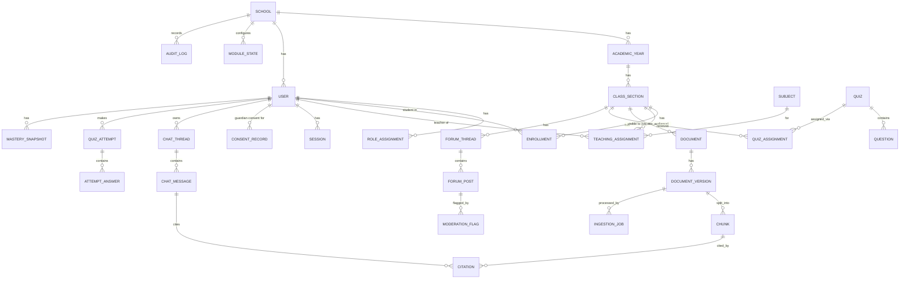

# RuralMinds Engineering Blueprint: an Offline-First, Malayalam/Manglish AI Learning Server for Rural Kerala Schools (October 2026)

RuralMinds should be built as one shared codebase that installs as a small Linux appliance on a CPU-only school machine. The stack: a FastAPI + SQLAlchemy/Alembic backend on SQLite (WAL), sqlite-vec plus FTS5 hybrid search, BGE-M3 embeddings, IndicXlit for Manglish normalisation, and Gemma 4 E2B/E4B (Apache 2.0) served by llama.cpp's `llama-server`. The frontend is a SvelteKit PWA. A signed, wizard-driven installer handles setup, and a separate cloud website hosts a synthetic-data demo. No student data leaves the school by default.


## TL;DR

- **Definitive stack:**
  - Python 3.12 + FastAPI + SQLAlchemy 2 + Alembic (`render_as_batch=True`) on SQLite WAL.
  - sqlite-vec + FTS5 hybrid retrieval with BGE-M3 dense embeddings.
  - IndicXlit (MIT, ~11M params) to turn Manglish into Malayalam script before retrieval.
  - Gemma 4 E2B (8 GB servers) / E4B (16 GB servers), Q4 GGUF on llama.cpp `llama-server`.
  - pypdfium2 + Tesseract (`mal+eng`) for documents.
  - SvelteKit static PWA frontend.
  - Native systemd services under an atomic "releases/current" layout, installed by a signed `.deb` that opens a browser setup wizard. No terminal needed.
- **The biggest real-world risks are not code. They are:**
  - **Malayalam generation quality of small models.** The official Gemma 4 card says "35+ languages out of the box, pre-trained on 140+" but publishes no Malayalam score. You must build and run your own Malayalam/Manglish test set before locking the model.
  - **CPU throughput.** Expect about 5–7 tokens/s for E2B on CPU, so a box serves roughly one class lab at a time, not a whole school at once.
  - **Textbook rights.** NCERT's e-content licence requires written permission to redistribute, and SCERT books carry "© Department of Education, Government of Kerala". So never bundle textbooks. Teachers upload them locally, and you should seek written permission from SCERT/KITE.
- **Networking and law shape the design:**
  - Service workers do not register on plain `http://<LAN-IP>`. So RuralMinds works without a service worker over HTTP (the server is already local), and offers optional HTTPS via a per-school subdomain certificate.
  - Students reach the server by QR code first, `ruralminds.local` (mDNS) second, and a fixed IP third.
  - Under the DPDP Rules (notified 13 Nov 2025; most obligations apply from 13 May 2027), everyone under 18 is a child. Keep the school as the Data Fiduciary, keep data local, collect no behavioural-advertising data, and use only strictly necessary cookies on the website.

---

## Key Findings (research evidence behind the decisions)

### 1. Models and licences changed decisively in 2026
- **Gemma 4 (released 2 April 2026) is Apache 2.0.** Earlier Gemma versions (Gemma 3 and before) used the more restrictive Gemma Terms of Use. Google's open-source blog calls Gemma 4 "the first in the Gemmaverse to be released under the OSI-approved Apache 2.0 license."
  - Edge sizes are E2B and E4B, with a 128K context and native audio input. That means you can redistribute bundled weights inside a school installer without bespoke licence terms; you only need to ship the licence text and NOTICE files.
- **Gemma 4 memory footprint on CPU:**
  - The QAT Q4 files are about 3.35 GB (E2B, "realistic RAM 8GB") and 5.15 GB (E4B, "8–16GB").
  - Unsloth's guide lists 4 GB (E2B) and 5.5–6 GB (E4B) total memory at 4-bit.
  - An exploratory llama.cpp test of E2B on a 2-core/4-thread AMD Athlon 3000G, CPU only (hardyweb, DEV Community), reported: "The best reported speed so far was 6.6 tokens per second, but the benchmark needs more controlled repetitions." Raspberry Pi 5 estimates are 3–8 tokens/s.
  - **Interpretation:** a 150-token answer takes about 20–30 s of generation on a weak CPU. The UX and queue design must assume this.
- **Malayalam evidence gap (from the targeted subagent search):** No official Malayalam-specific benchmark exists for Gemma 4 E2B/E4B, Gemma 3 4B or Qwen3.5 2B/4B.
  - Gemma 4's model card reports only MMMLU: 67.4% (E2B), 76.6% (E4B). It states "Out-of-the-box support for 35+ languages, pre-trained on 140+ languages" without listing which 35.
  - Gemma 3 4B (pre-trained) has an Indic average only: IndicGenBench 57.2, Flores Indic 52.3, XQuAD Indic 68.3.
  - Qwen3.5-2B/4B claim "201 languages and dialects" with MMMLU 63.1 (2B, thinking) / 76.1 (4B), but no per-language results.
  - The 2026 VakyArth benchmark (arXiv 2609.01788; 578 items, 134 of them Malayalam) found that "Indo-Aryan languages show a translation advantage over Dravidian languages, likely reflecting differences in pretraining coverage", though it notes the gap "is not consistent across MCQ and NLI".
  - Nobody has published Manglish (romanized/code-mixed Malayalam) results for any of these models.
  - **Conclusion:** model selection must be gated by your own evaluation (Section 4.6). That evaluation also strengthens your hackathon story.
- **Sarvam models are not suitable for bundling at small sizes:**
  - Sarvam-1 (2B) is under the "Sarvam AI Research License", which allows use "for non-commercial and research purposes only". It is also a base model "not… used directly as a chat or an instruction-following model".
  - Sarvam-M (24B) and Sarvam-30B/105B are Apache 2.0, but they are far too large for an 8–16 GB CPU server.
- **Qwen3.5 small models (0.8B/2B/4B/9B, released 2 March 2026) are Apache 2.0** and supported by llama.cpp. Qwen3.5-4B is the designated alternative if Gemma 4 E4B fails your Malayalam evaluation.

### 2. Retrieval for Malayalam and Manglish
- **BGE-M3** supports 100+ languages and dense, sparse and multi-vector retrieval, with inputs up to 8,192 tokens. Its published Malayalam IndicQARetrieval nDCG@10 is 0.7247, and an Indic fine-tune raises it to 0.7431.
- **But prior work summarised in arXiv 2511.22769 ("Modeling Romanized Hindi and Bengali") found "that strong models like BGE-M3 perform poorly on Romanized queries".** That evidence is from Indo-Aryan languages, not Malayalam, but it is the key reason for **transliterating Manglish to Malayalam script before retrieval**, rather than trusting the embedder to handle Latin-script Malayalam directly. Your own evaluation must confirm it for Malayalam.
- **IndicXlit** is "a transformer-based multilingual transliteration model (~11M) that supports 21 Indic languages for Roman to native script and native to Roman script conversions". Its code and models are MIT-licensed, and it is trained on the 26-million-pair Aksharantar corpus.
  - It is tiny enough to run constantly on CPU, and the same tool covers future languages (Tamil, Kannada, Hindi). That is why it sits behind a language-pack interface.
- **EmbeddingGemma (308M)** is the strongest sub-500M multilingual embedder on MTEB (Multilingual v2 mean 61.15). But v1 is under Gemma Terms; v2 is reported as Apache 2.0 only by a secondary source. BGE-M3 has a clearer licence (MIT) and a published Malayalam retrieval figure, so it wins for now. EmbeddingGemma 2 is the documented upgrade candidate.

### 3. Storage and vectors
- **sqlite-vec** is "a pure-C SQLite extension" under MIT or Apache-2.0. It does brute-force exact KNN, with reported latency of about 5 ms at 100K vectors and about 45 ms at 1M vectors.
  - A whole state syllabus is well under 200K chunks, so exact search is fast enough and avoids index-tuning bugs.
  - It inherits SQLite's ACID transactions, so chunks, metadata and vectors stay consistent.
- **Alembic** supports SQLite schema changes through "batch" (move-and-copy) mode. You enable it with `render_as_batch=True`, which "is safe to use in all cases" because it applies only on SQLite. This is what lets one ORM migration history serve SQLite schools today and a PostgreSQL district server later.

### 4. Documents and OCR
- **PyMuPDF is AGPL-3.0.** Distributing it inside your installer would impose AGPL obligations on the combined product. pypdfium2 (Apache-2.0/BSD-3) avoids this.
- **Surya OCR model weights use a modified OpenRAIL-M licence** with revenue/funding limits. Avoid them.
- **Tesseract (Apache 2.0)** was the only library supporting Malayalam among the five tested (Tesseract, MMOCR, PaddleOCR, EasyOCR, Keras OCR) in "Open-Source OCR Libraries: A Comprehensive Study for Low Resource Language" (ICON 2024), which reports "92% in English, 93% in Hindi, 78% in Tamil, 74% in Arabic, and 93% in Malayalam."

### 5. Networking facts that constrain the design
- **Service workers and PWA install need HTTPS or localhost.** MDN: "it must be served using the https protocol, or from a local development environment using localhost or 127.0.0.1". A plain-HTTP LAN IP "can never trigger the install prompt or register the service worker."
- **Android resolves `.local` mDNS names natively only from Android 12.** The Android Open Source Project's DNS Resolver documentation states "Starting from November 2021, Android resolver supports mDNS .local resolution" (VPN and mobile-data connections excluded), and Esper reports it was not backported to Android 10 or 11. Older Android phones, still common in rural Kerala, need the IP or QR fallback.
- **llama.cpp `llama-server`** has `--parallel N` slots with continuous batching, a `/slots` monitoring endpoint, router mode and a sleeping mode. On consumer hardware "--parallel 1 is usually the right call for interactive use", because slots share compute and the context budget.

### 6. Law and content
- **DPDP Rules 2025** were notified on 13 November 2025 (G.S.R. 846(E)) and are phased in:
  - Consent Manager provisions from 13 November 2026.
  - Notices, consent, children's data (Rule 10), security safeguards, 72-hour breach reporting to the Board and retention from **13 May 2027**.
  - Under-18s are children, which means verifiable parental consent and no tracking, behavioural monitoring or targeted advertising directed at children.
  - Educational institutions have specific exemptions from some parental-consent requirements (Fourth Schedule / Rule 12). This is why the school, not RuralMinds, should be the Data Fiduciary of student data.
- **NCERT e-content licence:**
  - Free download and reading, but distributors must give conspicuous attribution, and "any such act without the specific, written permission of NCERT will amount to infringement of copyright."
  - The Tribune (Chandigarh), reporting on a UT Vigilance/NCERT raid that seized 42 pirated books, wrote that "use of these online books as part of digital content packages or software is also prohibited. No website or online service is permitted to host these online textbooks."
  - SCERT Kerala textbooks are free on the KITE Samagra portal, but they carry "© Department of Education, Government of Kerala". I found no open licence.

---

## Section 1 — Finalized Technology Stack (one choice per component)

| Component | **Selected** | Why (evidence and reasoning) | Rejected alternatives |
|---|---|---|---|
| Server OS target | **Ubuntu 24.04 LTS / KITE GNU-Linux (Ubuntu-based)**, x86-64 with AVX2 | KITE (Kerala's school IT agency) maintains an Ubuntu-based distro used in government schools, so teachers already know it. LTS gives security updates. | Windows Server (licence cost, RAM), Raspberry Pi as primary (too slow for E4B) |
| Backend language/framework | **Python 3.12 + FastAPI + Uvicorn (1 worker, asyncio)** | The AI/NLP ecosystem (IndicXlit, tokenizers, Tesseract bindings, eval tooling) is Python. FastAPI gives typed OpenAPI contracts and native SSE streaming. One worker keeps RAM at about 150–250 MB. | Node/NestJS (weaker Indic NLP), Django (heavier, sync-first) |
| Schemas/validation | **Pydantic v2** | Shared request/response models; JSON Schema for module settings comes for free | Marshmallow |
| ORM | **SQLAlchemy 2.0 (typed `Mapped[]` models)** | Portable SQLite → PostgreSQL; mature; used directly by Alembic | SQLModel (thin layer, slower to fix edge cases), Prisma (Node) |
| Migrations | **Alembic with `render_as_batch=True`** | Officially supports SQLite move-and-copy ALTERs while staying normal on PostgreSQL | Hand-written SQL |
| Database | **SQLite 3 (WAL, `foreign_keys=ON`, `synchronous=NORMAL`)**, one file per school | Zero admin, single-file backup, fits 8 GB RAM. One school's write load (dozens of concurrent students) is well within WAL's single-writer limits. PostgreSQL remains a config switch for district deployments. | PostgreSQL on every school box (extra about 300 MB RAM, DBA burden) |
| Vector search | **sqlite-vec (`vec0` virtual tables), stored in a separate versioned index file** | Same ACID engine; MIT/Apache; exact KNN about 5 ms at 100K vectors; a separate file per index version allows rebuild-and-swap | LanceDB (heavier deps), Chroma (RAM-hungry), pgvector (needs Postgres) |
| Lexical search | **SQLite FTS5 (`unicode61` tokenizer, plus a transliterated-text column)** | BM25-style keyword search catches exact terms ("Pythagoras", "പ്രകാശസംശ്ലേഷണം") that dense vectors miss; built into SQLite | Tantivy, Elasticsearch |
| Embeddings | **BGE-M3 dense (1024-d), GGUF Q8_0, served by a second `llama-server --embedding` instance** | MIT licence; published Malayalam retrieval score (0.7247 nDCG@10); 8K input; one runtime for all models | EmbeddingGemma (licence ambiguity on v1; upgrade candidate), multilingual-e5 |
| Reranker | **bge-reranker-v2-m3 (GGUF), enabled only on the 16 GB profile, top-20 → top-5** | Cross-encoders improve precision on near-duplicate textbook passages. Disabled at 8 GB to protect latency. | ColBERT (index size) |
| Chunking | **Structure-aware chunker (own code): heading/section → paragraph, target 350 tokens, 15% overlap, never split equations/tables; page numbers retained** | Textbook answers need page-level citations; equations broken mid-chunk produce wrong answers | Fixed-size splitting |
| Manglish/transliteration | **IndicXlit (AI4Bharat, MIT) behind a `LanguagePack` interface** | ~11M params, 21 Indic languages, both directions | Aksharamukha (rule-based script conversion, good for native↔native but weak on informal phonetic spellings; kept as utility only), cloud APIs |
| LLM runtime | **llama.cpp `llama-server` (MIT), pinned release, bound to 127.0.0.1** | Explicit slot control (`--parallel`), `/health` and `/slots`, GGUF quantisation, embeddings and rerank in the same binary, no daemon magic | Ollama (convenient, but hides slot/KV control and adds a model registry layer we don't need), vLLM (GPU-oriented) |
| LLM | **Gemma 4 E4B-it Q4 (16 GB profile) / Gemma 4 E2B-it Q4 (8 GB profile)**; designated fallback **Qwen3.5-4B** if it fails the Malayalam evaluation | Apache 2.0, redistributable; 128K context; edge-optimised; multimodal (future voice input) | Sarvam-1 (non-commercial licence), Llama (custom licence), 9B+ models (RAM) |
| PDF extraction | **pypdfium2** (text and page rendering) | Apache-2.0/BSD-3; avoids AGPL PyMuPDF | PyMuPDF (AGPL), Docling (heavier; optional later for tables) |
| OCR | **Tesseract 5 with `mal` + `eng` traineddata**, invoked per page when the text layer is missing or non-Unicode | Apache 2.0, CPU-only, reported 93% Malayalam accuracy | Surya (weights licence), PaddleOCR (no Malayalam in the cited study) |
| Frontend | **SvelteKit 2 / Svelte 5, `adapter-static` SPA, TypeScript** | Small JS bundles for low-end Android phones; compiled reactivity; static files served by the backend, no Node at runtime | React/Next (heavier runtime), Flutter (app-store distribution) |
| PWA/offline | **vite-plugin-pwa (Workbox) + IndexedDB (via `idb`)**, active only on HTTPS origins | Standard precache plus runtime caching; degrades gracefully on HTTP | Hand-written SW |
| i18n | **Paraglide JS message catalogs (`ml`, `en`, future `ta`, `kn`…)** | Compile-time, tree-shaken translations; adding a language means adding a JSON file | i18next (runtime cost) |
| Reverse proxy/TLS | **Caddy 2** | Automatic HTTPS when a certificate is available, HTTP fallback, static file serving, rate limiting | Nginx (manual TLS lifecycle) |
| Auth | **Server-side sessions (opaque token, HttpOnly + SameSite=Lax cookie), Argon2id (argon2-cffi) for staff, class-code + picture-PIN for students, RBAC + class-scope ABAC in a policy module** | Revocable sessions, no JWT key management on an offline box, child-appropriate login | JWT, OAuth/Keycloak (overkill offline) |
| Background jobs | **In-process job runner backed by a `job` table (SQLite), executed by a separate `ruralminds-worker` systemd service at lower CPU priority** | No Redis/Celery RAM cost; jobs survive restarts | Celery + Redis |
| Testing | **pytest (+ pytest-asyncio, Hypothesis for normaliser fuzzing), Vitest, Playwright (incl. `context.setOffline`), Locust for load, pip-audit + osv-scanner** | Python-native load tests reuse API clients; Playwright simulates offline transitions | Cypress, k6 |
| Packaging/installer | **Signed `.deb` "ruralminds-installer" plus releases laid out as `/opt/ruralminds/releases/<ver>` with a `current` symlink; Python environment built with `uv`; artefacts signed with minisign (Ed25519) and listed in a SHA-256 manifest** | Double-click install on Ubuntu, atomic switch and rollback, verification works offline | Docker (extra concept for teachers; acceptable later for district servers), Snap |
| Website hosting | **One India-region VPS (8 vCPU/16 GB) behind Cloudflare (TLS, WAF, Turnstile); installer/model downloads on Cloudflare R2** | Edge TLS and bot protection on the free tier; R2 suits large downloads | Self-managed CDN |
| CI/CD | **GitHub monorepo + GitHub Actions; Renovate for dependency updates** | Free for public repos; reproducible release builds | — |

---

## Section 2 — Software Architecture

### 2.1 Two environments, one codebase

```mermaid
flowchart LR
  subgraph Cloud["Public website (ruralminds.in) — NO real student data"]
    WEB[Marketing + docs + legal pages]
    DEMO[Demo tenant: same app build, DEMO_MODE=true, synthetic data]
    PORTAL[Teacher portal: create school package]
    REL[(R2: signed releases, model packs, offline ISO)]
  end
  subgraph School["School LAN — the real deployment"]
    SRV[RuralMinds server box]
    AP[School Wi-Fi router / AP or server hotspot]
    PH[Student phones / lab PCs]
  end
  PORTAL -->|school.rmconfig signed| SRV
  REL -->|installer + models (online or USB)| SRV
  PH -->|HTTP/HTTPS over Wi-Fi| AP --> SRV
  SRV -. optional, opt-in: update checks + anonymous counters .-> Cloud
```

The **demo is the same application build** running with `DEMO_MODE=true`. That flag turns on synthetic tenants, quotas, a read-only model configuration and disposable storage, so the demo shows judges the real product, not a mock-up. The **school server never depends on the cloud**. Update checks and anonymous counters are opt-in and contain no personal data.

### 2.2 School server component diagram

```mermaid
flowchart TB
  subgraph Browser["Student / Teacher / Admin browser"]
    UI[SvelteKit SPA + optional Service Worker + IndexedDB outbox]
  end
  CADDY[Caddy :80/:443 — static files, TLS, rate limit, gzip]
  subgraph App["ruralminds-api (FastAPI, 1 process)"]
    AUTH[Auth & Policy]
    REG[Module Registry]
    CORE[Core: schools, users, classes, settings, audit]
    TUTOR[Module: ai_tutor]
    QUIZ[Module: quizzes]
    FORUM[Module: forum]
    ANALYT[Module: analytics]
    DOCS[Module: documents]
    RAG[RAG service: normalise → retrieve → prompt → stream]
    GOV[Inference Governor: queue, budgets, cancellation]
    HEALTH[Health & Diagnostics]
  end
  WORKER[ruralminds-worker — ingestion, OCR, embeddings, backups, analytics rollups]
  LLM[llama-server #1 :8081 Gemma 4 E2B/E4B]
  EMB[llama-server #2 :8082 BGE-M3 (+ reranker)]
  DB[(school.db — SQLite WAL)]
  IDX[(index/idx_vN.db — sqlite-vec + FTS5)]
  FS[(files/ — originals, page images, backups)]
  UI --> CADDY --> App
  TUTOR --> RAG --> GOV --> LLM
  RAG --> EMB
  RAG --> IDX
  App --> DB
  DOCS --> FS
  WORKER --> DB & IDX & FS & EMB
```

**Component responsibilities**
- **Caddy:** the only process listening on the LAN. It serves the static SPA and proxies `/api`, handles TLS when a certificate is present, applies per-IP rate limits, and sets security headers (CSP, `X-Content-Type-Options`, `Referrer-Policy`).
- **ruralminds-api:** a single process holding all business logic, plus the Module Registry, which decides which routers, navigation items and jobs are live.
- **Inference Governor:** the only code allowed to call the LLM. It owns the bounded queue, per-user limits, token budgets, timeouts and cancellation.
- **ruralminds-worker:** a separate systemd unit (`Nice=10`, `CPUWeight=20`) so heavy ingestion never freezes student chat. When the governor reports a non-empty chat queue, the worker pauses embedding batches.
- **llama-server instances:** bound to `127.0.0.1` only, never exposed on the LAN, so students can't bypass the governor.

### 2.3 Key technical decisions (ADR summary)
1. **Local-first, cloud-optional.** "Offline" means the internet is absent. The LAN is assumed present, because the server is the source of truth. This reframes offline: a student on the school Wi-Fi is "online" to RuralMinds even with no internet.
2. **One SQLite file for records, separate files for indexes.** Student records (`school.db`) are precious and migrated carefully. Indexes (`idx_vN.db`) are derived data that can always be rebuilt, so they are versioned and swapped, never migrated.
3. **All modules' tables exist in one linear migration history.** Enabling or disabling a module toggles behaviour, not schema. This removes a whole class of "enable module → migration fails" bugs and keeps data when a module is switched off.
4. **No LLM call without retrieval context for curriculum questions.** The tutor answers from the school's indexed material and cites pages. When nothing relevant is found, it says so and offers general help, clearly labelled.

### 2.4 Feature-module registration and admin configuration

Each module is a Python package that declares itself through an entry point (`[project.entry-points."ruralminds.modules"]`) and ships a manifest:

```yaml
# modules/forum/module.yaml
id: forum
name: {en: "Class Board", ml: "ക്ലാസ് ബോർഡ്"}
version: 1.2.0
requires_core: ">=1.0,<2.0"
depends_on: []                 # e.g. analytics depends_on: [quizzes]  (soft: optional)
optional_integrations: [ai_tutor]   # "Ask AI about this post"
permissions:
  - forum.thread.create   # student, teacher
  - forum.post.moderate   # teacher, admin
settings_schema:          # JSON Schema → admin UI form auto-generated
  type: object
  properties:
    students_can_post: {type: boolean, default: true}
    require_teacher_approval: {type: boolean, default: true}
    anonymous_posting: {type: boolean, default: false}
nav: [{role: student, icon: board, route: /board, order: 30}]
jobs: [forum.digest_daily]
```

**Registry behaviour:**
- **At startup:** discover manifests, validate the `requires_core` semver range, then topologically sort by `depends_on`. A module whose hard dependency is disabled is auto-disabled, and the admin sees the reason.
- **Toggling** is stored in `module_state(school_id, module_id, enabled, settings_json, updated_by, updated_at)`. Routers stay mounted but are wrapped in a dependency that returns `404 module_disabled`. That means no restart is needed, and disabled modules leak nothing.
- **Editions** are JSON presets over the same registry: **Lite** (tutor + quizzes), **Standard** (+ forum, documents), **Full** (+ analytics). The teacher picks one on the website and then fine-tunes in Admin → Features.
- **Upgrade compatibility:** a module's `settings_schema` carries a `settings_version`. Each module provides `migrate_settings(old_version, data) -> data`, so new settings get defaults instead of breaking.

### 2.5 Document ingestion flow



**Important Malayalam-specific step:** many older Malayalam PDFs use legacy ASCII-mapped fonts (ML-TT style), so the "text" extracts as Latin gibberish. The extractor runs a **script-validity check**: the ratio of Malayalam Unicode block characters (U+0D00–U+0D7F) to letters, plus a dictionary hit-rate. When the check fails, the page is routed to OCR. Test this on real SCERT PDFs in week 1. It is the most likely silent failure in the pipeline.

### 2.6 Question-answering flow



### 2.7 Network access, offline operation and synchronisation
Three **distinct delivery mechanisms**, never mixed up:
1. **Local-network access (primary):** phones and lab PCs reach the server over school Wi-Fi. Fully functional with no internet.
2. **Offline content distribution:** teachers export **Study Packs** (zip/HTML bundles of notes, quiz PDFs and answer sheets, *no* AI), which can be shared by USB, Bluetooth or printing for students without home connectivity.
3. **Remote/home access (deferred to v2, off by default):** would require an internet-reachable relay, stronger authentication and an updated parental consent. It is explicitly *not* in v1. Exposing a minors' data server to the internet is the single largest risk increase you could make.

**Synchronisation:** the only cloud sync in v1 is (a) pulling signed updates and model packs and (b) an opt-in daily push of anonymous aggregate counters (Section 8.5). There is no student-data sync. Within the LAN, the SPA uses an **IndexedDB outbox** for quiz answers and forum drafts, so a Wi-Fi drop mid-quiz loses nothing. Submissions carry a client-generated UUID (idempotency key), so retries can't double-count.

### 2.8 Error handling, resource limits and recovery
- **API errors** use RFC 9457 `application/problem+json` with a stable `code` (e.g. `tutor.queue_full`). The frontend maps each code to friendly Malayalam/English text with a next step ("Try again in a minute", "Ask your teacher").
- **systemd** runs every service with `Restart=on-failure`, `WatchdogSec` for the API, and `MemoryMax=` per service:
  - 8 GB profile: LLM 4.5 GB, embed 1.2 GB, API 600 MB, worker 1 GB.
  - 16 GB profile: LLM 7.5 GB, embed 2 GB.
  - So an OOM kills and restarts one service, not the whole box.
- **Crash-safe jobs:** jobs are rows with `status`, `attempts` and `heartbeat_at`. On worker start, any `running` job with a stale heartbeat is requeued, and after 3 attempts it is marked `failed` with a reason visible to the admin.

---

## Section 3 — Database and API Specifications

### 3.1 Entity-relationship diagram



### 3.2 Schema (core columns, constraints, indexes)

Conventions:
- **Primary keys:** `id` = UUIDv7 stored as TEXT. They are time-sortable and safe for future multi-school merge.
- **Every table** has `created_at`, `updated_at` (UTC ISO-8601, enforced by a `UtcDateTime` type) and, where relevant, `school_id` for future multi-tenant use.
- **Soft delete:** `deleted_at` on user-generated content.
- **Naming convention** in `MetaData` (`ix_%(column_0_label)s`, `uq_…`, `fk_…`, `ck_…`) so Alembic batch migrations stay deterministic.

| Table | Key columns | Constraints / indexes |
|---|---|---|
| `school` | id, name, udise_code, district, default_lang ('ml'), timezone ('Asia/Kolkata'), config_version | uq(udise_code) |
| `academic_year` | id, school_id, label ('2026-27'), starts_on, ends_on, is_current | one current per school (partial unique index) |
| `user` | id, school_id, kind ('student','teacher','admin','guardian'), display_name, username, password_hash (staff, nullable), pin_hash (students), picture_key, preferred_lang, status ('active','locked','archived'), failed_logins, locked_until | uq(school_id, username); ck(kind) |
| `role_assignment` | user_id, role ('student','teacher','head_teacher','admin','it_coordinator'), scope_type ('school','class_section'), scope_id | uq(user_id, role, scope_type, scope_id) |
| `class_section` | id, academic_year_id, grade (1–12), division ('A'), medium ('ml','en'), class_code (6-char, rotating) | uq(academic_year_id, grade, division); ix(class_code) |
| `enrollment` | student_id, class_section_id, roll_no, active | uq(student_id, class_section_id) |
| `subject` | id, code ('MATH'), names_json {ml,en} | uq(code) |
| `teaching_assignment` | teacher_id, class_section_id, subject_id | uq(all three) |
| `session` | id (random 256-bit, stored as SHA-256 hash), user_id, created_at, last_seen_at, expires_at, ip_hash, user_agent_short, revoked_at | ix(user_id), ix(expires_at) |
| `consent_record` | id, student_id, guardian_name, guardian_contact_hash, method ('paper_form','school_record'), scope_json (e.g. {ai_tutor:true, analytics:true, forum:true}), given_at, withdrawn_at, recorded_by | ix(student_id) |
| `module_state` | school_id, module_id, enabled, settings_json, settings_version, updated_by | pk(school_id, module_id) |
| `setting` | key, value_json, schema_version | pk(key) |
| `document` | id, title, subject_id, grade, chapter, language, source_type ('teacher_upload','licensed_pack'), rights_note, uploaded_by, status | ix(subject_id, grade) |
| `doc_audience` | document_id, class_section_id | pk(both) |
| `document_version` | id, document_id, file_sha256, file_path, page_count, mime, extractor_version, ocr_pages_json | uq(document_id, file_sha256) |
| `ingestion_job` | id, document_version_id, kind ('ingest','reembed','reindex'), status, progress (0–100), attempts, heartbeat_at, error_code, error_detail | ix(status) |
| `chunk` | id, document_version_id, ordinal, page_from, page_to, heading_path, text_native, text_translit, lang, token_count, content_hash, chunker_version | uq(document_version_id, ordinal); ix(content_hash) |
| `index_manifest` | id ('idx_v3'), embedder_id ('bge-m3-q8'), dim, chunker_version, normaliser_version, status ('building','active','retired'), built_at | one active (partial unique) |
| `chat_thread` | id, student_id, subject_id, title, created_at | ix(student_id, created_at) |
| `chat_message` | id, thread_id, role ('student','assistant','system_note'), text, lang_detected, reply_lang, model_id, latency_ms, tokens_out, status ('ok','cancelled','failed','refused') | ix(thread_id, created_at) |
| `citation` | message_id, chunk_id, rank, score | pk(message_id, chunk_id) |
| `quiz` | id, title, subject_id, grade, created_by, source ('teacher','ai_draft_approved'), status ('draft','published') | — |
| `question` | id, quiz_id, type ('mcq','true_false','short'), prompt_json {ml,en}, options_json, answer_key_json, explanation_json, chunk_ref, difficulty, skill_tag | ix(quiz_id) |
| `quiz_assignment` | quiz_id, class_section_id, opens_at, due_at, attempts_allowed | pk(quiz_id, class_section_id) |
| `quiz_attempt` | id, quiz_id, student_id, client_uuid, started_at, submitted_at, score | uq(client_uuid); ix(student_id) |
| `attempt_answer` | attempt_id, question_id, response_json, is_correct | pk(attempt_id, question_id) |
| `forum_thread` | id, class_section_id, subject_id, author_id, title, status ('pending','visible','hidden','locked') | ix(class_section_id, status) |
| `forum_post` | id, thread_id, author_id, body, status, edited_at | ix(thread_id) |
| `moderation_flag` | id, post_id, flagged_by, reason, resolved_by, resolved_at | — |
| `learning_event` | id, student_id, kind ('quiz_answer','tutor_question_topic','doc_view'), skill_tag, value, occurred_at | ix(student_id, occurred_at); retention 1 academic year |
| `mastery_snapshot` | student_id, skill_tag, mastery (0–1), updated_at | pk(student_id, skill_tag) |
| `glossary_term` | id, lang_pair ('en-ml'), source_term, target_term, aliases_json (Manglish spellings), subject_id | ix(source_term) |
| `audit_log` | id, actor_id, action ('user.reset_pin','module.disable','export.students'), target_type, target_id, ip_hash, at, details_json (no free text from students) | ix(at), append-only (trigger blocks UPDATE/DELETE) |
| `backup_record` | id, path, sha256, size, kind ('pre_upgrade','nightly','manual'), schema_rev, created_at | — |

The index database (`idx_vN.db`) contains:
`CREATE VIRTUAL TABLE chunk_vec USING vec0(chunk_id TEXT PRIMARY KEY, embedding float[1024], grade INTEGER, subject_id TEXT, lang TEXT);`
and `CREATE VIRTUAL TABLE chunk_fts USING fts5(chunk_id UNINDEXED, text_native, text_translit, tokenize='unicode61 remove_diacritics 0');`.
Diacritic removal stays off because Malayalam vowel signs are meaningful.

**Example ORM model (pattern for all tables):**

```python
class QuizAttempt(Base):
    __tablename__ = "quiz_attempt"
    id: Mapped[str] = mapped_column(String(36), primary_key=True, default=uuid7_str)
    quiz_id: Mapped[str] = mapped_column(ForeignKey("quiz.id", ondelete="CASCADE"), index=True)
    student_id: Mapped[str] = mapped_column(ForeignKey("user.id", ondelete="RESTRICT"), index=True)
    client_uuid: Mapped[str] = mapped_column(String(36), unique=True)   # idempotency
    started_at: Mapped[datetime] = mapped_column(UtcDateTime)
    submitted_at: Mapped[datetime | None] = mapped_column(UtcDateTime)
    score: Mapped[float | None]
    __table_args__ = (CheckConstraint("score IS NULL OR (score >= 0 AND score <= 100)"),)
```

### 3.3 Migrations policy
- `alembic/env.py`: `render_as_batch=True`, `compare_type=True`, plus a connect listener setting `PRAGMA foreign_keys=ON; journal_mode=WAL; busy_timeout=5000; synchronous=NORMAL`.
- **CI gates:**
  1. `alembic upgrade head` on an empty database.
  2. `alembic upgrade head` on **fixture databases from every previous release** (kept in `tests/fixtures/db/v*.db`).
  3. `alembic check` (models vs migrations drift).
  4. Downgrade one step for the latest revision.
- **Expand/contract rule:** a release may only *add* columns/tables, or *backfill*. Dropping or renaming happens at least one release later, after code stops using the old name. This is what makes rollback safe: the previous release's code still runs on the newer schema.
- **Per-school flexibility** without schema forks: school-specific fields go into typed `setting` keys or module `settings_json` validated by JSON Schema. Truly custom attributes (e.g. "house", "bus route") use a `custom_field` definition plus `custom_value(entity, field, value)` pair. These are deliberately not stored in core tables.

### 3.4 API (REST, `/api/v1`, JSON, OpenAPI generated)

| Method & path | Purpose | Request → Response (abridged) | Who |
|---|---|---|---|
| `POST /auth/staff/login` | Staff login | `{username, password}` → `204` + `Set-Cookie: rm_session` | anyone |
| `POST /auth/student/login` | Student login | `{class_code, student_id(picked from roster tiles), pin}` → `204` + cookie | anyone on LAN |
| `POST /auth/logout` | End session | → `204` | authenticated |
| `GET /me` | Profile, roles, enabled modules, nav | → `{user, roles, modules:[{id,nav,...}], lang}` | authenticated |
| `GET /classes/{id}/roster` | Roster | → `[{id, display_name, picture_key}]` (no PIN data) | teacher of class, admin |
| `POST /classes/{id}/students:reset-pin` | Teacher resets PIN | `{student_id}` → `{temp_pin}` (shown once) + audit | teacher of class |
| `POST /documents` (multipart) | Upload | file + `{title, subject_id, grade, chapter, audience:[class_ids], rights_note}` → `202 {document_id, job_id}` | teacher, admin |
| `GET /documents?grade=&subject=` | List | → paginated | teacher (own and school), student (audience only, metadata only) |
| `GET /jobs/{id}` | Ingestion progress | → `{status, progress, error_code}` | uploader, admin |
| `POST /tutor/threads` | New thread | `{subject_id?}` → `{thread_id}` | student, teacher |
| `POST /tutor/threads/{id}/messages` | Ask (SSE) | `{text, reply_lang?: 'ml'|'en'|'manglish'}` → `text/event-stream` events: `queued{position}`, `started`, `token{t}`, `citations[{doc_title,page,chunk_id}]`, `done{message_id}`, `error{code}` | thread owner |
| `DELETE /tutor/requests/{id}` | Cancel generation | → `204` | thread owner |
| `POST /tutor/messages/{id}/feedback` | 👍/👎/"too hard" | `{rating, reason?}` → `204` | owner |
| `GET /quizzes?assigned=me` | Student's quizzes | → list | student |
| `POST /quizzes/{id}/attempts` | Submit (idempotent) | `{client_uuid, answers:[{question_id,response}]}` → `{score, feedback[]}` | enrolled student |
| `POST /quizzes:draft-from-chunks` | AI-drafted questions | `{chunk_ids, n, types}` → `202 job` (teacher must approve) | teacher |
| `GET/POST /forum/classes/{id}/threads` | Board | `{title, body}` → thread (status `pending` if approval on) | class members |
| `POST /forum/posts/{id}:moderate` | Hide/approve | `{action, reason}` | teacher of class |
| `GET /analytics/classes/{id}/summary` | Class mastery | → `{skills:[{tag, avg_mastery, n}], at_risk_count}` | teacher of class, head teacher |
| `GET /analytics/me` | Own progress | → `{skills, streak}` | student |
| `GET/PUT /admin/modules/{module_id}` | Toggle/configure | `{enabled, settings}` (validated against schema) | admin |
| `GET /admin/health` | Diagnostics | → `{services[], queue_depth, p50_ttft_ms, disk_free_gb, last_backup, failed_jobs}` | admin, it_coordinator |
| `POST /admin/backups` / `POST /admin/restore` | Backup/restore | → job | admin |
| `POST /admin/updates:apply` | Apply signed bundle | multipart `.rmpkg` or `{channel:'stable'}` → job | admin |
| `GET /healthz` / `GET /readyz` | Liveness/readiness | → `200`/`503` | localhost + Caddy |

**Versioning:** URL major version (`/api/v1`). Additive changes only within v1. The SPA and API ship together in one release, so skew happens only with cached SPAs. To handle that, the API returns `X-RM-Min-Client`, and an outdated SPA shows a "Refresh to update" banner.

### 3.5 Authorization rules (enforced in one `policy.py`, unit-tested as a matrix)
A **role** grants a permission; **scope** limits it.
- **Students** see only their own threads, attempts, mastery and consent status, plus forum threads and documents for classes they're enrolled in.
- **Teachers** act on classes they have a `teaching_assignment` for.
- **Head teachers** get read-only aggregates school-wide.
- **Admins** configure the system but **cannot read students' tutor conversations** by default. Conversation access requires a recorded reason ("safeguarding concern"), is logged in `audit_log`, and is visible to the head teacher. This "break-glass" design protects confidentiality while allowing child protection.

---

## Section 4 — AI/RAG Implementation Specification

### 4.1 Hardware profiles (auto-detected)

| Profile | Detection | LLM | Embed/rerank | `--parallel` / ctx per slot | Expected |
|---|---|---|---|---|---|
| **Lite-8** | 8–11 GB RAM, ≥4 cores, AVX2 | Gemma 4 E2B-it Q4 QAT (about 3.35 GB file) | BGE-M3 Q8 (about 0.6 GB); no reranker | 1 / 4,096 | About 5–7 tok/s; a 1-student-at-a-time queue |
| **Standard-16** | ≥12 GB RAM, ≥6 cores | Gemma 4 E4B-it Q4 QAT (about 5.15 GB file) | BGE-M3 + bge-reranker-v2-m3 | 2 / 4,096 | About 3–6 tok/s per slot (to be measured) |
| **Unsupported** | <8 GB or no AVX2 | Tutor disabled; quizzes/forum/documents still work | — | — | The installer explains why, in plain language |

KV-cache settings: `--cache-type-k q8_0 --cache-type-v q8_0` and flash attention `auto` cut KV memory with minimal quality loss. `--ctx-size` equals parallel × 4,096, because llama-server divides the total context across slots.

### 4.2 Chunking, filtering and citation
- Structure-aware chunks of about 350 tokens (measured with the embedder's tokenizer) with 15% overlap. Equations, tables and numbered steps are kept intact. Each chunk is tagged with `heading_path`, `page_from/to`, grade, subject and language.
- **Hard filters before similarity:** `grade = student's grade (±1 optional)`, `subject_id` if the thread has one, and `doc_audience ∋ student's class`. Filtering first means a Class 6 student never gets Class 10 material, and keeps sqlite-vec scans small.
- **Hybrid retrieval:** for each query variant, take the top-20 dense hits (vec0) and top-20 FTS5 hits, then fuse with Reciprocal Rank Fusion (k = 60). On Standard-16, the reranker scores the top-20 and the top-5 go to the prompt.
- **Citations:** the prompt numbers sources `[1]..[5]` and requires `[n]` markers. The server checks each marker refers to a supplied chunk and renders "📖 Maths Class 9, p. 112". If the answer cites nothing and the top score is below threshold, the reply is prefixed: "This isn't from your textbook, check with your teacher."

### 4.3 Malayalam and Manglish query handling — worked example
Input: **"pythagoreas theorem simple aayith paranj theramo"**

1. **Script/language detection:** the input is 100% Latin script. Token classification uses (a) the `ml` pack's Manglish function-word lexicon (`aayi(t)(h)`, `paranj(u)`, `tharamo/theramo`, `enthaa`, `alle`…) plus (b) an English wordlist and the curriculum glossary. Result: `code-mixed ml-en`, intent marker "explain simply".
2. **Spelling repair against the curriculum glossary:** "pythagoreas" becomes "pythagoras" (edit distance 1, found in the `glossary_term` aliases). Domain terms are preserved, never transliterated.
3. **Transliteration (IndicXlit, top-k = 3):** Malayalam tokens only, giving "ആയിട്ട് പറഞ്ഞു തരാമോ". Keeping the top-3 candidates absorbs spelling variation (theramo/tharamo).
4. **Query variants:**
   - V1: original string
   - V2: "pythagoras theorem ലളിതമായി വിശദീകരിക്കുക" (glossary Malayalam name added, e.g. പൈതഗോറസ് സിദ്ധാന്തം)
   - V3: "pythagoras theorem simple explanation" (English terms plus intent)
   - Each variant is embedded and searched, then fused.
5. **Reply language policy:** default to the student's `preferred_lang`. If the student typed Manglish, reply in **Malayalam script with English technical terms in brackets**. A "Show in English letters" toggle back-transliterates the output with IndicXlit's native→roman model. This keeps the LLM generating in one script, which small models do more reliably than Latin-script Malayalam.
6. **Prompt template (`ml` pack):** a system role ("You are a patient teacher for a Class {grade} student in Kerala… use short sentences… use only the sources… if sources don't cover it say so"), then sources, then the question (V2 plus original).

**Transliterate-first vs multilingual-direct decision:** the default is **transliterate-first plus keep the original as a variant**. Prior evidence (from Hindi/Bengali) that BGE-M3 is weak on romanized input supports this. Fusing the raw variant protects against transliteration errors on English-heavy queries. The evaluation (4.6) must confirm it with three arms: A) raw only, B) transliterated only, C) fused. Keep C unless B or A beats it by ≥3 points of recall@5.

### 4.4 Language-pack interface (so new languages don't touch the pipeline)

```
lang_packs/ml/
  pack.yaml            # id, script ranges, translit model id, OCR traineddata, fonts
  function_words.txt   # Manglish markers
  glossary.csv         # en ↔ ml curriculum terms + romanized aliases
  prompts/*.j2         # system/answer/quiz-draft templates
  ui/messages.json     # Paraglide catalog
  eval/questions.jsonl # verified test set
```

```python
class LanguagePack(Protocol):
    code: str
    def detect(self, text: str) -> LangGuess: ...
    def normalise(self, text: str) -> list[QueryVariant]: ...
    def to_native(self, roman: str, k: int = 3) -> list[str]: ...
    def to_roman(self, native: str) -> str: ...
    def prompt(self, name: str, **ctx) -> str: ...
```

Adding Tamil means a new `lang_packs/ta/` with IndicXlit `ta`, Tesseract `tam`, a glossary, prompts and an eval set. The retriever, governor and UI shell stay unchanged.

### 4.5 Inference, concurrency and memory management (the Inference Governor)
- **Bounded queue:** an `asyncio.Queue(maxsize=QUEUE_MAX)` (Lite-8: 15, Standard-16: 30) feeds the workers. The number of workers equals the llama-server `--parallel` value.
- **When the queue is full:** return `429 tutor.queue_full` with a friendly message and the estimated wait.
- **Per-user limits:** one in-flight request per student, and a configurable 20 questions/hour (teachers can raise this during a lab period).
- **Budgets:** `max_tokens` 320 (students), 800 (teacher quiz-drafting, worker priority only). Prompt context is capped at 2,500 tokens. The request deadline is 90 s, and the stream is cut at the deadline with a "short answer" notice.
- **Cancellation:** if the SSE client disconnects or a `DELETE /tutor/requests/{id}` arrives, the governor cancels the httpx stream to llama-server, which frees the slot.
- **Model-loading policy:** the LLM stays resident during school hours (configurable timetable) and uses llama-server's sleep mode to unload after 30 min idle out of hours. Ingestion runs only while the chat queue is empty.
- **Answer cache:** a per-grade semantic cache keyed on (normalised question embedding ≥0.95 cosine, index version, model id) returns previously generated, teacher-unflagged answers instantly. In a class of 40 asking about the same chapter, this is the single biggest throughput win.
- **Honest capacity statement for judges:** on Lite-8, at about 6 tok/s, a 150-token answer takes about 25 s. With the cache and short answers, plan for **about 60–120 answered questions per hour** per box. That is enough for one class period of individual practice, and the UI shows the queue position.

### 4.6 Evaluation datasets, benchmarks and fallback behaviour
Published numbers don't cover Malayalam or Manglish for the chosen models, so the project **produces its own benchmark**, and that is a resume-grade contribution.

- **RM-Eval-ml v1 dataset (300 items to start):** Class 8–10 Maths and Science from SCERT chapters, used only internally for evaluation, never redistributed.
  - 100 English, 100 Malayalam-script, 100 Manglish. The Manglish items are written by at least 5 different students or teachers so they show real spelling variation, e.g. "pythagoreas/pythagoras", "paranj/paranju", "theramo/tharamo".
  - Each item has gold `chunk_id`s, a teacher-written reference answer, and the expected reply language.
- **Retrieval metrics:** recall@5 and MRR@10 per language bucket.
  - Acceptance: recall@5 ≥ 0.80 for English/Malayalam and ≥ 0.70 for Manglish.
- **Generation metrics (2 teachers rate blind, 1–5):**
  - Faithfulness to sources, correctness, simplicity for the grade, language correctness (script, grammar), and citation validity (automatic).
  - Acceptance: mean faithfulness ≥ 4.0, correctness ≥ 4.0, Malayalam fluency ≥ 3.5, citation validity ≥ 95%.
- **Model bake-off:** Gemma 4 E2B, Gemma 4 E4B and Qwen3.5-4B (Qwen3.5-2B for Lite-8), all Q4, same prompts, same retrieved context.
  - Also record tokens/s, time-to-first-token and peak RSS on your actual target hardware. Pick per profile. If none reaches Malayalam fluency ≥ 3.5, enable the **fallback path**: generate in English, then translate to Malayalam with an IndicTrans2 distilled model. Verify its licence and CPU latency before adopting it.
- **Fallback behaviour at runtime:**
  - LLM down: the tutor shows retrieved textbook passages ("Here is what your textbook says, page 112").
  - Embed server down: FTS5-only search.
  - Both down: the tutor tile shows "AI helper is resting, try quizzes", and other modules continue.

### 4.7 Prompt-injection and content safety
- Retrieved chunks are wrapped as quoted data with an explicit instruction that text inside sources is not instructions.
- Teacher uploads are the main injection vector; forum posts never enter the LLM context. Uploads are scanned for instruction-like patterns ("ignore previous", "system:") and flagged for the teacher.
- An output filter blocks personal data patterns (phone numbers, Aadhaar-like 12-digit runs) and a Malayalam/English abusive-word list. The model is never given tools or network access, so a successful injection can at worst produce bad text, which the 👎 report path surfaces to teachers.

---

## Section 5 — Frontend and UX Specification

### 5.1 Design principles for first-time, anxious users
- **Four big tiles, no menus, for students:** Ask (ചോദിക്കാം), Practice (പരിശീലനം), Class Board (ക്ലാസ് ബോർഡ്), My Progress (എന്റെ പുരോഗതി). The icon, word and colour stay the same on every screen.
- **Malayalam first**, English toggle in the header. Font: Noto Sans Malayalam (OFL) bundled locally, 18 px minimum body text, 48 × 48 px minimum touch targets, WCAG 2.2 AA contrast.
- **Never a silent wait:** every action shows state ("Your question is 3rd in line ⏳ about 40 s"). Tokens stream as they arrive. A big **Stop** button is always visible.
- **Forgiving input:** Manglish, Malayalam or English all accepted, with no "invalid input" errors. A **"Say it more simply"** button reruns at a lower reading level, and a **"I still don't understand → tell my teacher"** button adds the question to the teacher's inbox anonymously within the class.
- **No dead ends:** every error screen has one primary action and a picture.
- **Login without passwords for kids:** tap your class card, tap your photo/avatar, enter a 4-digit PIN. Five wrong tries locks the account for 5 minutes and shows "Ask your teacher to help". Teachers reset PINs from the roster.

### 5.2 Page structures
- **Student:** Login → Home (4 tiles) → Ask (thread list, chat, citations drawer) / Practice (assigned quizzes, attempt, result with explanations) / Class Board (threads, post) / Progress (skill stars, streak, no rankings and no comparison with classmates).
- **Teacher:** Home (today's class, pending moderation, "students who asked for help") → Classes (roster, PIN reset) → Materials (upload, ingestion progress, preview chunks) → Quizzes (create, AI-draft → review → publish, assign) → Board moderation → Insights (class skill heatmap, at-risk list).
- **Admin / IT coordinator:** Dashboard (health lights, storage, queue, last backup) → Features (module toggles plus settings forms) → Users & Classes (CSV import) → Network (address, QR poster, Wi-Fi test) → Updates & Backups → Privacy (consent register, retention, data export/erase) → Diagnostics bundle.

### 5.3 Wireframes (ASCII)

```
┌──────────── RuralMinds ─────── [മല | EN] ──┐
│  Hi Anu 👋                                   │
│  ┌─────────────┐  ┌─────────────┐           │
│  │   💬        │  │   ✏️         │           │
│  │ ചോദിക്കാം   │  │ പരിശീലനം    │           │
│  │  Ask        │  │ Practice (2)│           │
│  └─────────────┘  └─────────────┘           │
│  ┌─────────────┐  ┌─────────────┐           │
│  │   🧑‍🤝‍🧑      │  │   ⭐         │           │
│  │ ക്ലാസ് ബോർഡ് │  │ എന്റെ പുരോഗതി│           │
│  └─────────────┘  └─────────────┘           │
└──────────────────────────────────────────────┘

┌─ ← Ask · Maths ──────────────────────────────┐
│ You: pythagoreas theorem simple aayith        │
│      paranj theramo                           │
│ ┌ RuralMinds ───────────────────────────────┐ │
│ │ ഒരു മട്ടത്രികോണത്തിൽ (right triangle)... │ │
│ │ a² + b² = c²  [1]                          │ │
│ │ 📖 Maths 9, p.112   📖 Maths 9, p.114      │ │
│ │ [🔤 English letters] [🙂 Simpler] [👍][👎] │ │
│ └────────────────────────────────────────────┘ │
│ ⏳ 2nd in line…                    [ ■ Stop ] │
│ ┌──────────────────────────────┐ [ ➤ Send ]   │
│ │ Type in Malayalam/Manglish/EN│              │
└──────────────────────────────────────────────┘

┌─ Admin · Features ───────────────────────────┐
│ AI Tutor        [ON ]  Questions/hour: [20]  │
│ Quizzes         [ON ]                        │
│ Class Board     [OFF]  (data kept)           │
│ Insights        [ON ]  needs: Quizzes ✓      │
│ ── Server: 🟢 AI  🟢 Search  🟡 Disk 82%      │
└──────────────────────────────────────────────┘
```

### 5.4 Offline caching and recovery
- **On HTTP (default):** no service worker. The SPA is small (<300 KB gzipped target) and served from the LAN, so loads are fast. Drafts and quiz answers persist in IndexedDB (available in non-secure contexts), and a reconnect banner retries the outbox with exponential backoff and idempotency keys.
- **On HTTPS (optional upgrade):** a Workbox service worker precaches the app shell, fonts and icons, caches "last 20 tutor answers" and assigned quizzes. The app becomes installable to the home screen. The API and SSE are never cached; quiz submission uses the outbox.
- **Recovery UX:**
  - If the server is unreachable: "Can't reach the school computer. Check you're on the school Wi-Fi 'RuralMinds-GHSS'." A big **Try again** button, and a QR rescan hint.

### 5.5 Live demo vs locally installed feature boundaries

| Feature | Live demo (website) | Local install |
|---|---|---|
| Student AI tutor on pre-indexed **sample** chapters (openly licensed or self-written content) | ✅ (quota-limited) | ✅ full |
| Manglish/Malayalam query normalisation, citations | ✅ | ✅ |
| Quizzes (take, AI-draft, approve) | ✅ synthetic class | ✅ |
| Class Board | ✅ sandboxed per demo session | ✅ |
| Analytics dashboards | ✅ synthetic students | ✅ real |
| Admin module toggles | ✅ per-session copy | ✅ |
| Teacher upload of own PDFs | ⚠️ one sample PDF from a curated list only (no arbitrary uploads: copyright and malware) | ✅ |
| Hardware detection, LAN discovery, QR poster, backups, updates | ❌ (shown as a guided video/simulator) | ✅ |
| Real student accounts or consent records | ❌ never | ✅ |

---

## Section 6 — Installation and Deployment Specification

### 6.1 Hosted website and isolated live demo
- **Topology:** Cloudflare (DNS, TLS, WAF, Turnstile) → VPS running Caddy → `website` (static docs/legal) + `portal` (teacher accounts, package builder) + `demo` (RuralMinds build with `DEMO_MODE=true`). Each runs in its own container with its own database file, so the demo can never touch portal data.
- **Demo isolation:** each visitor who passes Turnstile gets a **demo session** = a copy-on-create SQLite file cloned from a golden synthetic school ("GHSS Demo, Kottayam"), with 3 synthetic students and 1 teacher. It expires after 45 min idle and is destroyed by a cron sweeper. No email is required to try it.
- **Quotas (anti-exhaustion):**
  - 10 tutor questions per session, 30 per IP/day, `max_tokens` 200.
  - Global LLM concurrency 2 and a queue of 20. If the queue is full, show "Demo is busy, watch the 60-second video".
  - Per-ASN anomaly throttling at Cloudflare. A daily token budget kill-switch flips the demo tutor to cached sample answers when exceeded.
  - Uploads disabled except curated samples. Request body ≤ 16 KB on chat.
- **Abuse prevention:** output length caps, the same safety filters as local, logs keep only counts and hashed IPs (7 days), and a "Report output" link.
- **Secrets:** the release-signing key never lives on the VPS. It sits offline (YubiKey or an offline laptop), and CI signs only via a protected environment requiring manual approval. Portal and session secrets live in systemd credentials or environment files with root-only permissions, rotated per release.
- **Backups:** nightly encrypted (age) portal DB dumps to R2, retained 30 days; the demo DB is not backed up because it is disposable.
- **Retention:** teacher portal accounts are deleted after 24 months of inactivity, with a reminder email first. Demo data is deleted on expiry. Web server logs are kept 14 days.

### 6.2 Downloadable installer and school setup wizard
**On the website, the teacher:**
1. Creates a portal account (an adult teacher; email verification).
2. Fills **Create School Package**: school name, UDISE code, district, medium(s), grades, edition (Lite/Standard/Full), optional modules, preferred language(s), and hardware ("I'll detect on the machine" is recommended).
3. Downloads:
   - (a) `ruralminds-installer_<ver>_amd64.deb` (the same file for every school, about 150 MB including Python runtime, Caddy, llama.cpp and Tesseract data)
   - (b) `school.rmconfig` (signed JSON with school settings and a one-time setup token)
   - (c) a model pack (`models-lite8-<ver>.rmmodels` about 4 GB, or `standard16` about 7 GB), resumable over HTTP range requests
   - **Or (d)** the **offline USB image**, which bundles a–c for schools with poor internet. One download at a BRC/AEO office or library can serve many schools.

**On the school machine (no terminal):**
1. Double-click the `.deb`. Ubuntu's App Center installs it after asking for the admin password once. Its post-install step starts `ruralminds-setup` and opens `http://localhost:8800/setup`. Setup is reachable only on localhost.
2. **Wizard steps** (each with a progress bar, plain Malayalam/English, and Back/Next):
   1. **Welcome and language.**
   2. **Load school file:** drag `school.rmconfig` in, or type the 8-character setup code to fetch it.
   3. **Hardware check:** RAM, CPU cores, AVX2 flag, free disk (≥ 25 GB required), sustained-temperature check. Shows a profile ("Your computer can run: Standard-16 ✅").
   4. **Features:** pre-ticked from the edition; untick to remove.
   5. **Models:** detects a USB model pack, or downloads with resume. Verifies SHA-256 and the minisign signature, and shows "Verified ✓".
   6. **Create admin and first teacher accounts** (Argon2id passwords, with a printed recovery code).
   7. **Database initialisation:** `alembic upgrade head`, seed subjects, glossary and language pack.
   8. **Network setup** (see 6.4): pick "Use school Wi-Fi router" or "This computer creates the Wi-Fi". Reserve the address and print the QR poster.
   9. **Self-test:** loads the LLM, runs 3 canned questions (en/ml/Manglish), measures time-to-first-token and tokens/s, checks a phone can reach it ("Scan this QR with any phone, a green tick appears here when it connects").
   10. **Done:** shows the student address and QR, the teacher address, and "Print posters".
3. **Interrupted installs:** each wizard step is idempotent and recorded in `/var/lib/ruralminds/setup-state.json`. Restarting resumes at the last incomplete step. Model downloads resume from partial files (`.part` + byte offset). Nothing is activated until the self-test passes.

**Dependency installation:** the `.deb` is self-contained. It includes a relocatable Python built with `uv`, pinned wheels, Caddy, llama.cpp CPU builds (AVX2 and AVX-512 variants, chosen at runtime) and Tesseract plus traineddata. That avoids `apt` network dependencies during install. Its only declared system dependencies are packages present on stock Ubuntu (`systemd`, `avahi-daemon`, `network-manager`).

### 6.3 Hardware detection and configurable features
- **Detection reads:** `/proc/meminfo`, `/proc/cpuinfo` flags, `lscpu`, `statvfs`, `/sys/class/thermal`.
- **Profile rules:** as in Section 4.1. The admin can downgrade (e.g. force Lite-8 to free RAM for other lab use), but upgrade only if the check passes.
- **Re-detection** runs after each upgrade and on demand ("Re-check hardware").

### 6.4 Local network setup, firewall and service discovery
**Two network modes:**
- **Mode A — School router:** the server joins the existing Wi-Fi/LAN.
  - The wizard detects the gateway and DHCP range and recommends (1) creating a DHCP reservation on the router (it shows the server's MAC and illustrated steps for common router brands). If the teacher can't, it uses (2) NetworkManager to set a **static IP outside the DHCP pool** (e.g. `.250`) after an ARP probe confirms the address is free.
- **Mode B — Server hotspot:** the server's Wi-Fi card (or a USB Wi-Fi adapter) creates `RuralMinds-<School>` (WPA2, password on the poster) via NetworkManager, with its own DHCP and DNS (dnsmasq).
  - It is the most reliable mode for schools without a managed router, and it lets the server answer *every* DNS name locally, so `ruralminds.school` and captive-portal-style redirects work.
  - Limit: about 15–25 phones on typical laptop Wi-Fi hardware. Recommend a cheap dedicated AP for full classes.

**Discovery (layered, most-robust first):**
1. **QR code poster:** encodes `http://<ip>/s/<class_code>`. It is regenerated automatically if the IP changes, and the admin dashboard warns "Reprint posters".
2. **`http://ruralminds.local`** via Avahi mDNS. Works on Windows, macOS/iOS, Linux and Android 12+. Older Android phones fall back to QR or IP.
3. **Short numeric IP** printed on the poster.
4. **Mode B only:** any URL typed lands on RuralMinds (DNS wildcard).

**DHCP change and router-restart recovery:**
- NetworkManager dispatcher hooks detect address changes, update the Avahi record and QR, and log an admin alert.
- Services bind to `0.0.0.0` behind Caddy, so they need no restart.
- Because a reservation or static IP was configured during setup, a router reboot normally changes nothing.
- The **"Find my RuralMinds"** page on the website tells a teacher how to locate the server (check the poster, or use the server's local screen which always shows the current address).

**Client/AP isolation:** many routers enable "AP isolation" on guest SSIDs, which blocks phone-to-server traffic. The self-test detects this: the phone can't reach the server while the server can reach the gateway. The wizard then shows "Turn off 'AP isolation'/'client isolation' on your router or use the main (not guest) Wi-Fi", or offers Mode B.

**Firewall (nftables via ufw, applied by the installer):**
- Allow inbound TCP 80/443 from RFC 1918 LAN subnets only, UDP 5353 (mDNS), and UDP/TCP 53 and UDP 67 in Mode B only.
- Deny everything else inbound. `llama-server` (8081/8082), the setup UI (8800) and the API (8000) bind to 127.0.0.1.
- SSH is disabled by default; IT coordinators can enable it with a key from Admin → Diagnostics.

**HTTPS option (recommended where internet exists at least monthly):**
- The portal issues each school a name like `ghss-kottayam-7f3a.lan.ruralminds.in`. The server obtains a Let's Encrypt certificate via **DNS-01** through a narrowly scoped portal API. No inbound internet exposure is needed.
- Public DNS returns the server's *private* LAN IP, and in Mode B dnsmasq answers locally. Media servers such as Plex use the same pattern.
- **Caveat:** some routers' DNS-rebinding protection blocks public names resolving to private IPs, and renewals need periodic internet. Caddy therefore keeps HTTP working, and the SPA treats HTTPS (service worker, install-to-home-screen) as an enhancement, never a requirement.

### 6.5 Secure updates, migrations, backups and rollback
- **Update artefact:** `ruralminds-<ver>.rmpkg` = tar.zst with `manifest.json` (version, min_from_version, schema_rev, files + SHA-256), signed with minisign. The public key ships inside the installer and can be rotated via a signed key-rotation record. It is delivered online (stable channel) or by USB.
- **Apply procedure** (Admin → Updates → "Install", one button):
  1. Verify the signature and hashes; refuse if `min_from_version` is not met.
  2. Check disk space ≥ 2× DB + release size.
  3. **Pre-upgrade backup:** `VACUUM INTO` creates a consistent copy of `school.db` plus the config and module states, recorded in `backup_record`.
  4. Unpack to `/opt/ruralminds/releases/<ver>/`.
  5. Run `alembic upgrade head` against the live DB (expand-only migrations).
  6. Restart services onto the new release in a staging slot and run `/readyz` plus the 3 canned questions.
  7. Switch the `current` symlink atomically, keeping the previous 2 releases.
  8. **On any failure:** switch the symlink back. Because migrations are expand-only, the previous code runs on the new schema. Restore the DB from the pre-upgrade backup only if a migration itself failed midway; batch-mode migrations run in a transaction where SQLite allows. The admin sees a plain-language message.
- **Model/index upgrades are separate from code upgrades:**
  - A new release that changes only the LLM swaps the GGUF file; no re-indexing.
  - A change of embedder or chunker creates `idx_v(N+1).db` *in the background*, reusing chunks whose `content_hash` and `chunker_version` are unchanged and re-embedding only those. Queries keep using `idx_vN` until the new index is complete and passes a smoke test, then `index_manifest` flips. This answers "must not require all educational material to be reprocessed unnecessarily".
- **Backups:**
  - Nightly `VACUUM INTO` plus a copy of `files/` metadata to `/var/lib/ruralminds/backups` (keep 7 daily, 4 weekly).
  - A **"Back up to USB"** button writes an encrypted (age, school passphrase) archive.
  - **Restore** is a wizard: choose backup → verify checksum → show date and counts → confirm → restore → migrate to current head.

---

## Section 7 — Security and Reliability Requirements

### 7.1 Threat model (STRIDE-lite, prioritised)

| # | Threat | Likely actor | Control | Test that proves it |
|---|---|---|---|---|
| T1 | Student reads another student's chats/marks | Curious student | Policy layer with owner/class scope on every query; IDs are UUIDv7 (not guessable sequentially) | Authorisation matrix tests: every endpoint × every role × own/other resource |
| T2 | PIN brute force | Student | 5 tries then lockout; per-IP rate limit at Caddy; PINs hashed with Argon2id | Automated brute-force test hits lockout at attempt 6 |
| T3 | Session theft on shared lab PCs | Student | 8-hour session expiry for students, 30-min idle; "Log out" prominent; auto-logout on browser close for lab-mode PCs | E2E test of idle expiry |
| T4 | Malicious upload (PDF exploit, zip bomb, huge file) | Compromised/curious teacher account | 50 MB limit, magic-byte check, page-count cap (600), parsing in the worker under `MemoryMax`, `NoNewPrivileges`, `ProtectSystem=strict`, no network; files stored outside the web root with random names | Fuzz corpus of malformed PDFs; zip-bomb test |
| T5 | Prompt injection via uploaded material | Document content | Sources quoted as data, injection-pattern flagging, no tools, output filters | Red-team suite of 50 injection prompts in en/ml/Manglish; must produce 0 policy violations |
| T6 | Harmful/incorrect AI answers to minors | Model | Source-grounded answers, "not from textbook" labelling, 👎 reporting to teacher, abusive-word filter | Teacher review of eval outputs; safety prompt set |
| T7 | LAN attacker sniffs traffic (HTTP mode) | Someone on the Wi-Fi | WPA2 on the network; HTTPS option; session cookies `HttpOnly`, `SameSite=Lax`, `Secure` when on HTTPS; no sensitive data in URLs | Header checks in CI |
| T8 | Exposure of the server to the internet | Misconfigured router port-forward | Firewall allows LAN subnets only; admin dashboard warns if a public IP is ever seen in requests | Simulated WAN-source request is rejected |
| T9 | Tampered update or model | Supply chain | minisign signature, SHA-256 manifest, pinned dependency hashes, SBOM per release | Tampered-bundle test must be refused |
| T10 | Admin over-reach on children's private questions | Insider | Break-glass access with recorded reason, audit log visible to head teacher, aggregate-only analytics by default | Audit test asserts a log row on every conversation read |
| T11 | Data loss (disk failure, failed upgrade) | Hardware | Nightly backups, USB export, pre-upgrade backup, restore drill | Quarterly restore drill on a fixture database |

### 7.2 Permissions matrix

| Resource / action | Student | Teacher (own classes) | Head teacher | Admin | IT coordinator |
|---|---|---|---|---|---|
| Own tutor chats | R/W | — | — | Break-glass R (logged) | — |
| Class tutor *topics* (aggregate, no text) | — | R | R | R | — |
| Quizzes: take | ✓ assigned | — | — | — | — |
| Quizzes: create/assign | — | ✓ | ✓ | — | — |
| Class Board: post | ✓ (if enabled) | ✓ | ✓ | — | — |
| Class Board: moderate | — | ✓ | ✓ | ✓ | — |
| Documents: upload | — | ✓ | ✓ | ✓ | — |
| Analytics per student | Own | ✓ | ✓ | — | — |
| Roster / PIN reset | — | ✓ | ✓ | ✓ | — |
| Module toggles / settings | — | — | R | ✓ | R |
| Backups / updates / network | — | — | — | ✓ | ✓ |
| Consent register | — | R (own classes) | ✓ | ✓ | — |
| Audit log | — | — | R | R | R (technical events only) |

### 7.3 Privacy design (DPDP-aligned)
- **Roles:** for each local deployment, **the school (or the education department) is the Data Fiduciary**. RuralMinds the project supplies software and has no access to student data, so it is not a processor of that data. This must be stated in the school licence and privacy notice. On the hosted portal, RuralMinds is the Data Fiduciary for *teacher* accounts (adults) only.
- **Children (all under 18):**
  - The school records verifiable parental/guardian consent using the school's existing admission records or a paper form logged in `consent_record`, with scope per module. Educational institutions have specific exemptions in the Rules, but **a lawyer should confirm which exemption covers which module before the May 2027 deadline**, especially learning analytics, which could be read as "behavioural monitoring".
  - Design choices that minimise risk: no advertising, no third-party trackers, analytics computed locally and shown to the student's teachers only, no cross-school profiling, no student data in the cloud.
- **Data minimisation:** students need only a display name, class and roll number. No phone, email or Aadhaar fields exist in the schema.
- **Retention defaults (admin-configurable):**
  - Tutor chats: 1 academic year, then deleted.
  - Learning events: 1 academic year.
  - Quiz attempts: duration of enrolment plus 1 year.
  - Audit log: 1 year minimum. The DPDP Rules emphasise log retention for security, so check the final rule text for the exact period.
- **Rights:** a data export (JSON/PDF) and erase per student from Admin → Privacy. A grievance contact appears on the notice. Breach playbook: the school informs affected parents without delay, and the Board within 72 hours, using a template in the admin docs.

### 7.4 Website terms, privacy and cookies
- **Privacy Policy (website/portal):** what we collect (teacher name, email, school name/UDISE; hashed IP for abuse prevention), why, retention (above), no sale or sharing, processors (Cloudflare, VPS host, email provider), rights and grievance officer contact, a children's statement ("The website is for teachers; the demo uses only synthetic student data; do not enter real student information"), and a DPDP-compliant notice in English and Malayalam.
- **Terms of Service:** demo provided "as is" with quotas; acceptable use (no real student data, no attempts to overload or jailbreak the demo, no unlawful uploads); AI-output disclaimer (educational aid, verify with teachers); licence terms for the downloadable software (state the open-source licence of your code, e.g. Apache-2.0, plus a third-party notices file); governing law India; jurisdiction of Kottayam courts (confirm with an adviser).
- **School Deployment Licence & Data Notice:** the school is the fiduciary, the software has no telemetry by default, update/metrics opt-in, the school's responsibility for consent and uploaded content rights.
- **Cookies:** use only strictly necessary cookies (`rm_portal_session`, `rm_demo_session`, Turnstile's functional cookie) and cookieless, self-hosted aggregate analytics, or none.
  - This avoids a consent banner under EU ePrivacy-style rules (strictly necessary cookies are exempt).
  - DPDP has no cookie-specific rule, but any personal data processing needs notice and lawful basis, so describe the cookies in the privacy policy.
  - **GDPR:** relevant only if you offer services to people in the EU or monitor them. A Kerala-focused teacher portal doesn't target the EU, so GDPR is largely inapplicable. The minimal-cookie design keeps you compliant anyway if the scope changes.
- **Hosting security checklist:** HTTPS everywhere (HSTS), TLS at Cloudflare *and* origin (origin certificate), SSH key-only with no root login, unattended security upgrades, CSP without `unsafe-inline`, rate limits, Fail2ban on SSH, secrets out of git (pre-commit secret scanning), weekly dependency scans, and a quarterly restore test of portal backups.

### 7.5 Licence compliance register (ship `THIRD_PARTY_NOTICES.md` in every release)

| Component | Licence | Obligation | Status |
|---|---|---|---|
| Gemma 4 E2B/E4B weights | Apache 2.0 | Include licence and NOTICE; state modifications (quantisation) | ✅ bundle |
| Qwen3.5 (fallback) | Apache 2.0 | Same | ✅ bundle if selected |
| BGE-M3 / bge-reranker-v2-m3 | MIT / Apache 2.0 (verify reranker card at build time) | Include licence | ✅ |
| IndicXlit | MIT | Include licence; cite Aksharantar paper | ✅ |
| Aksharantar data (not shipped) | CC-BY / CC0 | Attribution if used for fine-tuning | n/a |
| llama.cpp | MIT | Include licence | ✅ |
| Tesseract + traineddata | Apache 2.0 | Include licence | ✅ |
| pypdfium2 / PDFium | Apache-2.0 / BSD-3 | Include licences | ✅ |
| sqlite-vec | MIT or Apache-2.0 | Include licence | ✅ |
| SQLite | Public domain | — | ✅ |
| Caddy | Apache 2.0 | Include licence | ✅ |
| Noto Sans Malayalam | SIL OFL 1.1 | Include OFL | ✅ |
| PyMuPDF | AGPL-3.0 | Would force AGPL on the combined product | ❌ excluded |
| Surya OCR weights | Modified OpenRAIL-M with revenue limits | Restrictions | ❌ excluded |
| Sarvam-1 | Sarvam non-commercial research licence | Non-commercial only | ❌ excluded |
| NCERT textbooks | NCERT e-content licence | Written permission needed to distribute | ❌ never bundled; teacher-uploaded for school use only |
| SCERT Kerala textbooks | © Dept. of Education, Govt. of Kerala | No open licence found | ❌ never bundled; request written permission from SCERT/KITE |

**Content-rights position:** RuralMinds distributes *software and models only*. Schools upload textbooks they already lawfully obtain from the Samagra portal, and the content stays on the school's own server for instruction. India's Copyright Act section 52(1)(i) (reproduction by a teacher or pupil in the course of instruction) may support this. But The Tribune reports that NCERT prohibits use of its online books "as part of digital content packages or software", so you should (1) get a written opinion and (2) **apply to SCERT/KITE for permission or partnership**. A KITE endorsement would also be the strongest possible signal to judges. The demo uses only self-authored sample chapters.

### 7.6 Test plans and measurable release gates
- **Authentication:** login/lockout/reset flows; session expiry; CSRF (SameSite plus a double-submit token on state-changing staff endpoints); the authorisation matrix (≥ 1 test per cell in 7.2). **Gate: 100% of matrix tests pass.**
- **Offline transitions (Playwright):**
  - Kill Wi-Fi mid-quiz, then restore: the attempt is submitted exactly once.
  - Kill the LLM mid-stream: the student sees the partial answer plus a friendly error, and the slot is freed within 2 s.
  - Server reboot during an ingestion job: the job resumes.
  - Router restart: phones reconnect via the QR/IP within 60 s of DHCP renewal.
- **Failure recovery:**
  - Failed migration on a fixture DB leads to automatic rollback with the student count unchanged.
  - Corrupted update bundle is refused.
  - Restore from USB backup reproduces identical row counts and checksums.
- **Performance targets (Lite-8 reference box: 4-core/8-thread x86 with AVX2, 8 GB, SSD):**
  - API p95 < 300 ms for non-AI endpoints at 40 concurrent users.
  - Tutor time-to-first-token p50 < 6 s with an empty queue.
  - Retrieval (normalise + hybrid search) p95 < 800 ms.
  - Idle RAM < 5.5 GB with the model loaded.
  - Ingestion ≥ 20 text pages/min and ≥ 3 OCR pages/min without raising chat TTFT by more than 20%.
- **Load scenarios (Locust):**
  - (1) "Class period": 40 students, each asking 3 questions over 15 minutes while 10 take quizzes. Expect no 5xx, queue positions accurate, cache hit-rate reported.
  - (2) "Exam morning": 200 quiz submissions in 5 minutes.
  - (3) "Abuse": one client firing 100 requests/s gets throttled without degrading others.
- **Security:** pip-audit/osv-scanner with no high/critical findings; CSP and header checks; malformed-PDF fuzzing; the prompt-injection red-team set.

---

## Section 8 — Phased Implementation Roadmap

### 8.1 Repository structure (monorepo)

```
ruralminds/
├─ apps/
│  ├─ api/                 # FastAPI app
│  │  ├─ ruralminds/core/  # config, db, auth, policy, registry, audit, errors
│  │  ├─ ruralminds/modules/{ai_tutor,quizzes,forum,analytics,documents}/
│  │  │     ├─ module.yaml ├─ router.py ├─ service.py ├─ models.py ├─ jobs.py └─ tests/
│  │  ├─ ruralminds/rag/   # normaliser, chunker, retriever, governor, prompts
│  │  ├─ ruralminds/ops/   # health, backups, updates, hardware, network
│  │  └─ alembic/
│  ├─ worker/              # job runner entrypoint (shares api package)
│  ├─ web/                 # SvelteKit SPA (student/teacher/admin route groups)
│  ├─ setup-wizard/        # SvelteKit pages for localhost:8800 + Python backend
│  └─ portal/              # website + teacher package builder + demo controller
├─ lang_packs/ml/  (later: ta/, kn/, hi/)
├─ packaging/ (deb/, systemd/, caddy/, usb-image/, signing/)
├─ eval/ (datasets/, runners/, reports/)
├─ docs/ (ADR/, user-guides/ml|en, legal/)
└─ .github/workflows/
```

### 8.2 Milestones (dependency-ordered; adjust weeks to your hackathon dates)

| Milestone | Tasks by module | Tests required to close |
|---|---|---|
| **M0 Foundations (wk 1)** | Repo, uv/pnpm, CI; SQLAlchemy base, naming convention, SQLite pragmas, Alembic batch; core tables (school, user, class, session, module_state, audit); problem+json errors; ADRs 1–4 | Migration up/down on empty DB; pragma assertions; lint/type checks (ruff, mypy, svelte-check) |
| **M1 Auth & roles (wk 2)** | Staff + student login, PIN lockout, sessions, policy module, roster CSV import | Full authorisation matrix skeleton; brute-force test |
| **M2 Documents & ingestion (wk 2–3)** | Upload, worker, pypdfium2, script-validity check, Tesseract fallback, chunker, `idx_v1` with vec0 + FTS5, embed server | Real SCERT PDFs (Malayalam and English medium) extract correctly; legacy-font page goes to OCR; malformed PDF fuzz |
| **M3 Language pack `ml` + eval harness (wk 3)** | Detector, glossary, IndicXlit wrapper, variants; build RM-Eval-ml v1 (start with 150 items) | Retrieval eval arms A/B/C reported; recall@5 targets tracked |
| **M4 AI tutor (wk 4)** | Governor (queue, budgets, cancellation), prompts, SSE, citations, answer cache, fallbacks; model bake-off on target hardware | TTFT/tok-s report per profile; cancellation frees slot; fallback paths E2E |
| **M5 Student & teacher UI (wk 4–5)** | 4-tile home, chat, Malayalam UI, quizzes (take/create/AI-draft/approve), progress page | Playwright journeys; accessibility audit (axe) with no serious violations; usability test with 5 students |
| **M6 Forum, analytics, admin features (wk 5)** | Board with moderation; learning events → mastery rollup; Features page from manifests; health dashboard | Module toggle tests (disable → 404, data kept); analytics shows aggregates only |
| **M7 Installer, network, updates (wk 6)** | `.deb`, setup wizard, hardware check, Mode A/B networking, QR posters, mDNS, firewall, backups, `.rmpkg` updates and rollback | Fresh-install on a clean Ubuntu VM and a real low-end PC; interrupted-install resume; tampered bundle refused; rollback drill |
| **M8 Website, demo, legal (wk 6–7)** | Portal, package builder, demo sessions + quotas + Turnstile, privacy/terms/notice pages, R2 downloads | Load test on demo; quota kill-switch; header/CSP checks |
| **M9 Pilot hardening (wk 7–8)** | Pilot in one Kottayam school lab; fix top 10 issues; final eval report | All release gates in 7.6 met |

### 8.3 Risks and mitigations

| Risk | Likelihood/impact | Mitigation |
|---|---|---|
| Small-model Malayalam quality insufficient | High / High | Eval-gated choice; Qwen3.5-4B alternative; English-generate + translate fallback; short, source-grounded answers |
| CPU too slow for class-wide use | High / Medium | Answer cache, queue UX, per-student limits, teacher "lab mode" scheduling, Standard-16 hardware recommendation |
| Legacy-font Malayalam PDFs | High / Medium | Script-validity check → OCR; test on real files in week 1 |
| Textbook rights challenge | Medium / High | No bundling; local teacher upload; SCERT/KITE permission request; self-authored demo content |
| Router AP isolation / DHCP chaos | Medium / Medium | Self-test detection, reservation/static IP, Mode B hotspot, QR regeneration |
| SQLite write contention | Low / Medium | WAL, short transactions, worker batches in small commits; Postgres path proven in CI |
| Scope creep before judging | High / Medium | The edition system: ship Lite fully polished first, then Standard |

### 8.4 Technical-debt controls and definition of done
- **Technical-debt controls:**
  - ADR for every cross-cutting decision.
  - `alembic check` and an OpenAPI diff in CI, so breaking API changes fail the build.
  - Coverage ≥ 80% on `core/` and `rag/`, ≥ 60% elsewhere.
  - Dependency updates weekly via Renovate.
  - No module may import another module's internals; communication goes through core services or events (enforced by import-linter).
- **Definition of done (per feature):**
  - Migrations and tests merged; policy rules added to the matrix.
  - Malayalam and English UI strings present.
  - Works on a 2019-era Android phone in Chrome over HTTP.
  - Telemetry-free logging verified (no student free text in logs).
  - Docs in `docs/user-guides/ml|en`.
  - Release notes entry.

### 8.5 Resource governance and observability (what the admin sees, without reading students' questions)
- **Structured JSON logs (journald):** request id, route, status, latency, model id, tokens in/out, queue wait, `lang_bucket` (`en|ml|manglish`). **Never the question text.** The question text lives only in `chat_message`, under policy control.
- **Health dashboard lights:**
  - AI engine: `/health` and `/slots` of llama-server; TTFT p50 over the last 50 requests; a "slow model" alert when tokens/s falls below 50% of the self-test baseline, which usually indicates thermal throttling or swap.
  - Search: embed server health.
  - Ingestion: failed jobs listed with a reason code such as `ocr.timeout` or `pdf.encrypted`, plus a "Retry" button.
  - Storage: alert at 80% and 90% disk; per-school upload quota, default 10 GB.
  - Services: systemd unit states and restart counts.
  - Backups: last success time.
- **Diagnostics bundle:** one button creates a zip of logs (already content-free), config with secrets redacted, hardware info and the self-test results, for sending to a mentor or the RuralMinds team.
- **Privacy-preserving usage metrics (opt-in upload):**
  - Daily counts only: questions per language bucket, quiz attempts, active students (rounded to the nearest 5), p50 latency, module enablement.
  - Buckets under 5 are suppressed, and there are no identifiers. This proves impact to judges and funders without touching minors' data.

---

## Judging and Impact Strategy

**What to demo (a 5-minute script):**
1. Unplug the internet cable from the router on stage, and keep it unplugged.
2. A student phone scans the QR and taps their avatar and PIN.
3. They ask "pythagoreas theorem simple aayith paranj theramo" and get a Malayalam answer citing "Maths 9, p.112". Tap "English letters" to show the Manglish rendering.
4. The teacher uploads a chapter, and the progress bar finishes within a minute. Ask a question from it.
5. The admin turns off the Class Board, and it disappears from the student home instantly.
6. Open the health dashboard: RAM, queue and tokens/s. Then show the privacy page: no student data leaves the school.

**Evidence to bring:**
- The RM-Eval-ml results table (arms A/B/C, models compared, latency on a ₹25–35k PC).
- One real pilot photo.
- The DPDP and licence registers.
- Judges reward **proof** over feature lists. Your own Manglish benchmark is something no competitor will have.

**Why it scales:**
- One codebase with editions, signed offline updates, USB distribution through BRC/AEO offices, and language packs (Tamil and Kannada are configuration plus data, not rewrites).
- A PostgreSQL path for a district hub later.

**Resume lines this earns:**
- "Designed and built an offline-first RAG platform serving Malayalam/Manglish queries on CPU-only hardware (Gemma 4, llama.cpp, sqlite-vec), with a signed update/rollback system, a modular plugin architecture, and DPDP-aligned privacy-by-design for minors."
- "Created a 300-item Malayalam/English/Manglish educational retrieval benchmark and showed transliteration-first retrieval improved Manglish recall@5 by X points."

---

## Caveats

- **The Project knowledge files were not readable in this session.** Feature scope is taken from your request. Reconcile Section 8 with the `/claude` docs before sprint planning.
- **Performance numbers are third-party estimates.** The 6.6 tok/s figure for Gemma 4 E2B comes from an exploratory test on a 2-core AMD Athlon 3000G (hardyweb, DEV Community), which its author says "needs more controlled repetitions". The 3–8 tok/s Pi 5 figures and the Gemma 4 file sizes also mostly come from blogs rather than official benchmarks. Measure on your actual school hardware in M4 before promising latency.
- **No published Malayalam or Manglish score exists for Gemma 4 E2B/E4B or Qwen3.5 small models.** The model choice is provisional until your evaluation runs. The fallback options are documented.
- **EmbeddingGemma 2's Apache 2.0 licence** is reported by a secondary source; verify it on Google's model card before switching. Also verify the bge-reranker-v2-m3 and IndicTrans2 licences at build time.
- **DPDP:** dates and Rule 10 obligations are well corroborated (13 Nov 2025 notification; 13 May 2027 for substantive obligations). The exact scope of the educational-institution exemptions, and whether learning analytics counts as "behavioural monitoring", needs legal confirmation. Some secondary sources misstate the notification date as "early 2025".
- **Copyright:** the section 52(1)(i) reasoning is an argument, not advice. Get a written opinion and seek SCERT/KITE permission.
- **Unverified engineering assumptions:**
  - The HTTPS-via-public-subdomain approach depends on router DNS behaviour and periodic internet.
  - Mode B hotspot capacity (about 15–25 clients) depends on the Wi-Fi chipset.
  - Both must be validated in the pilot school.